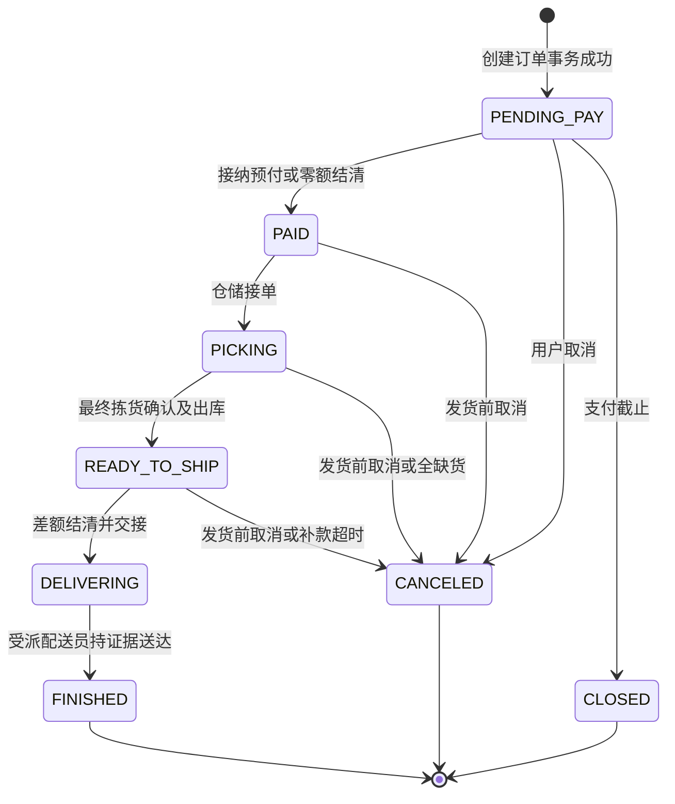
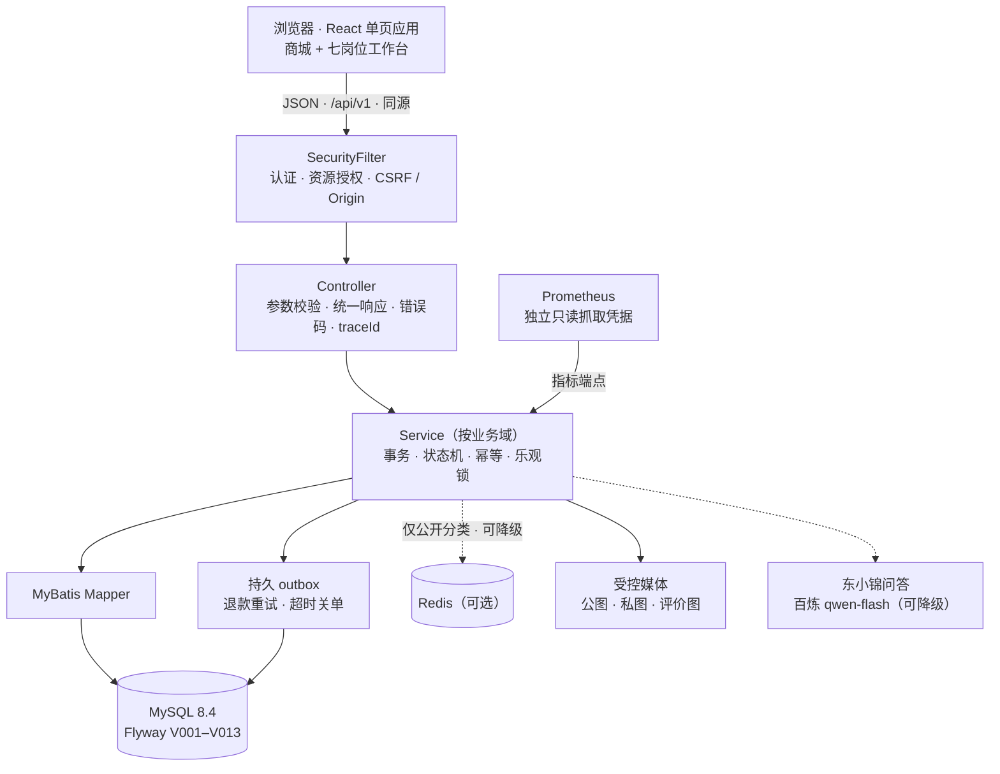
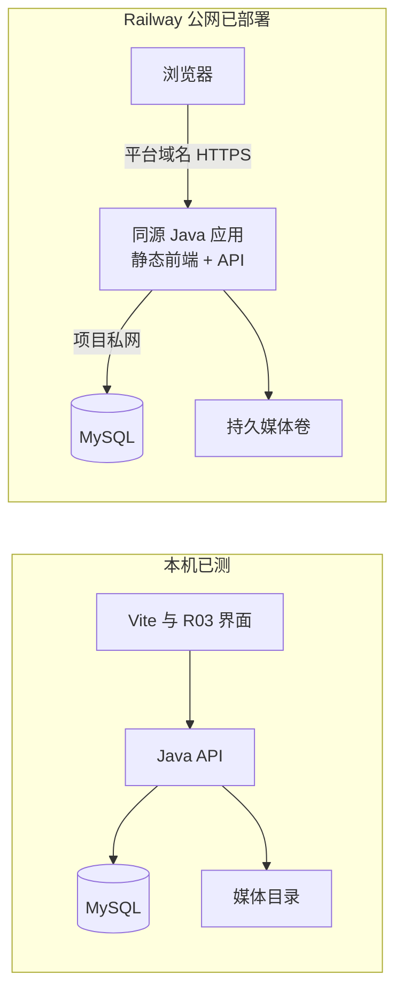

# fresh-mall · 东华大学社区生鲜超市系统

> 《AI辅助软件开发》实验四「企业级应用——商城系统」小组项目 · 接口契约 0.2.2（95 个操作 / 176 个 schema）· 冻结工程版本 v0.3.1

面向东华大学社区的单店单仓生鲜电商系统：会员浏览商品、预约配送、沙箱支付并跟踪订单与售后；拣货、配送、客服、财务、运营和系统管理员在各自的岗位工作台处理履约与经营。系统以“契约优先、模块化单体、批次库存（FEFO）、幂等与可恢复的资金流程”为设计主线。文中所有结论以实际构建、启动和测试结果为准，未执行的验收项均明确标注。

| 入口 | 地址 |
|---|---|
| 在线演示（课程沙箱） | <https://freshmart-enterprise-production.up.railway.app/> |
| 源码仓库 | <https://github.com/gorneynienhuis-lang/freshmart-enterprise> |
| 三份正式文档（第一版） | [需求文档](docs/formal/企业级需求文档.md) · [设计文档](docs/formal/设计文档.md) · [测试报告](docs/formal/测试报告.md) |
| 复现与使用 | [快速开始](#快速开始) · [本机运行](deploy/README.md) · [登录与后台使用](docs/登录与后台使用.md) |

> 支付与退款为课程沙箱，不发生真实扣款；校园场景为课程设定，不代表获得学校运营授权；全部演示数据均为合成数据。

## 关键指标

| 维度 | 数据 | 口径与证据 |
|---|---|---|
| 接口契约 | 95 个操作 / 176 个 schema | [`contracts/openapi.yaml`](contracts/openapi.yaml)，人工维护，前端类型由其生成 |
| 数据库 | 43 张业务表 · 13 个 Flyway 迁移 | MySQL 8.4.11，[`database/migrations`](database/migrations) V001–V013 |
| 后端测试 | 195 项通过（0 失败 / 错误 / 跳过） | JaCoCo 行覆盖 94.72%（2046/2160），分支覆盖 69.41%，见[测试报告](docs/formal/测试报告.md) |
| 前端测试 | 44 项通过，含类型检查、生成漂移检查、生产构建 | Vitest 5.0.5 |
| 真实浏览器复验 | 七角色 70 个响应 · 四个页面三种宽度共 12 张截图 | Playwright 1.62.1，schema / JS / 缺图 / 外溢均为 0，见 [`docs/evidence/review-state-v031`](docs/evidence/review-state-v031) |
| 监控告警 | 8 条规则；宕机与退款 DEAD 告警实测 FIRING → INACTIVE | Prometheus 3.15.0，见 [`docs/evidence/monitoring-v030`](docs/evidence/monitoring-v030) |
| 种子数据 | 7 个角色账号 · 40 个商品 · 45 个 SKU · 136 个批次 | 合成数据，见 [`database/seed`](database/seed) |

## 任务书对照

| 实验目的（任务书） | 本仓库的对应内容 |
|---|---|
| 1. 需求分析与业务建模 | [§3 需求与业务](#3-需求与业务) · [需求文档](docs/formal/企业级需求文档.md) · [状态模型](contracts/state-models.md) · [权限契约](contracts/permissions.md) |
| 2. 技术选型与开发环境 | [§4 选型表](#4-系统架构与技术选型)（理由 / 替代方案 / 风险）· [ADR-001](collab/decisions/ADR-001-后端技术栈.md) |
| 3. 分层架构、模块化与统一 API 规范 | §4 架构图与统一约定 · [接口约定](contracts/conventions.md) · [OpenAPI](contracts/openapi.yaml) |
| 4. 核心业务闭环与数据一致性 | §3 · §6 数据一致性条目 · [业务规则](contracts/business-rules.md) |
| 5. 安全、性能与可靠性 | [§6 企业级能力对照](#6-企业级能力对照) |
| 6. AI 编程全流程与关键决策记录 | [§9](#9-ai-辅助开发与可追溯性) · `collab/ai-log/` · `collab/decisions/` |
| 7. 工程化交付与部署运维 | §7 · §8 · §10 · `deploy/` |
| 8. 团队协作、文档与表达 | [§2 团队与分工](#2-团队与分工) · [§11 交付物与进度](#11-交付物与进度) |

## 1. 项目概述

**业务闭环**：浏览 / 搜索 → 购物车 → 服务端报价 → 预约配送下单 → 沙箱付款 → FEFO 拣货与称重 → 差额退补 → 配送签收 → 售后 → 退款与对账 → 评价。

**设计针对的业务问题**

- 新鲜度与临期：批次台账 + FEFO（先到期先出），临期专区与临期价，过期与隔离批次不可分配。
- 称重商品价格不确定：按估重预付、实重多退少补，超估重 10% 拒绝拣货提交，补款未结清不得发货。
- 配送履约：预约时段与名额在下单事务中原子占用，取消时释放。
- 品质售后与资金安全：已完成订单 7 天内按订单行限额申请；审核与退款执行职责分离；退款可重试、可人工恢复、可对账。

**范围边界**：单自营门店、单仓、单币种 CNY；不做多商户、多仓拆单、骑手路径优化、付费会员、秒杀与微服务拆分（取舍理由见[需求文档](docs/requirements-v0.1.md)与 [ADR-001](collab/decisions/ADR-001-后端技术栈.md)）。

**产品内 AI**：吉祥物“东小锦”提供导购问答，后端经 OpenAI 兼容接口调用阿里云百炼模型（默认 `qwen-flash`，可配置），限制历史条数与回答长度；未配置密钥或调用失败时自动降级为预设常见问题。密钥不入库。

## 2. 团队与分工

本项目为四人小组作业：主负责人 1 名、任务负责人 3 名。三位任务负责人分别承担视觉品牌、功能需求与生鲜业务三个方向的设计与需求输入，并参与验收证据采集；主负责人统筹技术路线、需求整合、工程实现与最终交付。三位成员的原始成果作为输入保留，经统一基线整合后落地为契约、种子数据与界面，整合处理记录见[需求文档源稿 §2](docs/requirements-v0.1.md)。

| 角色 | 成员 | 方向 | 在交付中的位置 |
|---|---|---|---|
| **主负责人（组长）· MEMBER D** | 戴家轶（GitHub：[gorneynienhuis-lang](https://github.com/gorneynienhuis-lang)） | 总体决策 · 需求整合与契约 · 工程实现统筹 · 验收与交付 | **关键路径**：源码、设计、测试、部署与最终集成 |
| 任务负责人 · MEMBER A | 戚宇暄 | 创意设计 · 视觉与品牌设计 | 品牌与界面输入、演示视觉 |
| 任务负责人 · MEMBER B | 李金瑞 | 产品策划 · 商城功能与需求设计 | 需求与权限输入、需求文档与追踪 |
| 任务负责人 · MEMBER C | 刘寒立 | 业务策划 · 生鲜商品与业务场景设计 | 商品数据与业务流程输入、业务与测试验证 |

### 主负责人 · MEMBER D（戴家轶）

主负责人对技术路线、需求基线与最终交付负总责，工程实现阶段借助 Codex 与 Claude 完成（见 [§9](#9-ai-辅助开发与可追溯性)）。

1. **立项与路线决策**：确定“契约优先 + 模块化单体 + AI 辅助实现”的路线，并以 [ADR-000](collab/decisions/ADR-000-协作方式与前端技术栈.md) / [ADR-001](collab/decisions/ADR-001-后端技术栈.md) / [ADR-002](collab/decisions/ADR-002-登录限流与密码口径.md) 留痕。
2. **需求整合与契约基线**：整合任务书与三位成员的输入，统一业务规则、状态机、权限与接口契约（`contracts/`，基线 v0.2.2）。
3. **核心工程实现统筹**：身份与会话安全、批次库存与 FEFO 预占、报价与下单事务、沙箱支付与回调幂等、拣货称重差额、配送签收、售后退款与对账、员工治理与审计、Redis 降级缓存、监控告警、备份恢复。
4. **质量与验收**：后端 195 项测试、真实 MySQL 与浏览器七角色回归、故障注入与恢复演练；失败尝试全部保留，不改写为通过。
5. **部署与发布**：本机一键复现、Railway 公网课程展示环境、Compose 与 CI 模板、版本标签与 PR 流程（#1–#5 已合并）。
6. **视觉方案确认**：选定 R03 为主要界面，确认吉祥物“东小锦”（见 [MASCOT-APPROVED-005](collab/codex/MASCOT-APPROVED-005.md)）。
7. **AI 协作治理**：工具分工、七要素记录与证据归档。

### MEMBER A · 创意设计 · 视觉与品牌设计（戚宇暄）

负责商城整体形象，让项目拥有独特的视觉风格。

- 商城名称、宣传语、Logo 与主题配色
- 设计卡通 IP 吉祥物（可自由发挥）
- 首页、商品详情、购物车、个人中心、管理后台的 UI 布局
- 使用 AI / Canva / Figma 制作页面参考图

**最终成果**：品牌与 UI 设计方案 + Logo / 吉祥物 / 页面素材

**已交付输入**：品牌与 UI 设计方案、提示词库、5 页 UI 参考图、Logo / 吉祥物 / 表情素材。基线采用其为商品展示素材与创意参考，品牌与界面在 R03 方案中重新设计。

**当前与后续**：验收证据采集（用户端页面与业务闭环）、PPT 视觉设计、视频画面包装，见下方工作包。

### MEMBER B · 产品策划 · 商城功能与需求设计（李金瑞）

负责商城做什么、有哪些功能，以及用户如何使用。

- 整理商城功能清单，区分必做与选做
- 设计游客、会员、管理员等角色权限
- 规划购物车、下单、支付、配送、售后流程
- 设计订单状态与商城特色功能

**最终成果**：功能需求说明书 + 功能优先级表 + 角色权限表

**已交付输入**：功能清单与角色权限草表、带量化指标的非功能需求、API 清单草案、“模块化单体”架构取向。基线采用其功能主题与非功能目标，权限与验收条件重写，API 以统一契约为准。

**当前与后续**：验收证据采集（角色权限与越权拦截）、需求文档定稿、需求追踪矩阵，见下方工作包。

### MEMBER C · 业务策划 · 生鲜商品与业务场景设计（刘寒立）

负责让商城有真实的商品、购物场景和生鲜特色。

- 设计 6~8 个生鲜商品分类
- 整理 30~50 个商品的价格、规格、库存和图片来源
- 绘制从选购到收货的完整业务流程图
- 策划预约配送、临期提醒、优惠活动等特色玩法

**最终成果**：商品数据 Excel + 生鲜业务策划方案 + 流程图

**已交付输入**：8 个分类、40 个商品 / 45 个 SKU 及批次数据与商品图片、12 张业务流程图、接口文档草案、FEFO / 临期 / 称重业务思路。基线保留其业务编码与业务主线，清理库存冲突与过期种子后重建契约、状态机与种子数据。

**当前与后续**：验收证据采集（源码、测试、监控与异常）；已在 Windows 环境复现并反馈后端测试问题，促成 [PR #5](https://github.com/gorneynienhuis-lang/freshmart-enterprise/pull/5)（依赖 POSIX 文件权限的测试在 Windows 下自动跳过、修正时钟精度测试）；业务流程图与状态机对齐。

### 验收证据采集分工

分工与文件命名详见[真实截图采集清单](docs/formal/真实截图采集清单.md)。

| 负责人 | 范围 | 编号 |
|---|---|---|
| MEMBER A | 用户端页面与业务闭环 | UI-01 – UI-08 · TEST-04 · TEST-05 |
| MEMBER B | 角色权限与越权拦截 | AUTH-01 – AUTH-11 |
| MEMBER C | 源码、测试、监控与异常 | ENG-03 – ENG-09 · TEST-01 – TEST-03 · TEST-06 – TEST-08 · OPS-01 – OPS-08 |
| MEMBER D | GitHub 与 Railway | ENG-01 · ENG-02 · GH-03 – GH-06 |

截图原则：保留地址栏；密码、手机号、Cookie、Token、密钥与个人信息一律打码；没有真实结果时截取代码 / 配置 / 未执行状态，文件名加 `-NOT-RUN`，不以示例数据冒充实测。

### 后续交付工作包

| 编号 | 工作包 | 负责人 | 完成标准 | 状态 |
|---|---|---|---|---|
| WP-01 | 用户端页面与业务闭环截图 | A | 清单规定的文件齐全，地址栏可见，敏感信息已打码 | 已布置 |
| WP-02 | 角色权限与越权拦截截图 | B | 每个岗位一张；401 / 403 / 404 各至少一张 | 已布置 |
| WP-03 | 源码、测试、监控与异常截图 | C | 未执行项以 `-NOT-RUN` 标注；与测试报告的状态一致 | 已布置，已反馈 Windows 测试问题 |
| WP-04 | 需求文档定稿（DEL-02） | B | 含用例图、业务流程图、领域模型、ER 图、API 清单、可验证非功能需求；FR-01 – FR-14 可追踪 | 计划中 |
| WP-05 | 业务流程图与状态机对齐 | C | 12 张流程图与 [状态模型](contracts/state-models.md) 一致；商品数据与种子（40 商品 / 45 SKU）对账无冲突 | 计划中 |
| WP-06 | 需求 → 接口 → 用例 → 证据追踪矩阵（测试报告附录） | B | 覆盖 FR-01 – FR-14；无证据的条目写 NOT_RUN | 计划中 |
| WP-07 | PPT 视觉设计与排版（DEL-05） | A | 与冻结版本一致；指标均出自测试报告 | 程序冻结后开始 |
| WP-08 | 视频分段脚本与包装（DEL-06） | A 画面包装 · B 角色权限段 · C 业务闭环段 | 不超过 15 分钟；覆盖任务书规定的八类内容；展示真实运行，不只放 PPT | 程序冻结后开始 |
| WP-09 | AI 使用七要素记录补录 | 全员（D 汇总） | 每次使用 AI 的记录含七要素及对话 / 截图；版本未知写“未知”，不补造历史 | 进行中 |
| WP-10 | 设计文档定稿、测试报告主体、源码 / SQL / 部署 ZIP（DEL-01、03、04） | D | 与冻结版本、迁移、契约和证据一致 | 进行中 |
| WP-11 | 公网七角色回归、Linux 容器验证、远端 CI 激活、视频技术段（架构、企业级能力、AI 使用与复现、测试与部署、总结） | D | 见 [§12](#12-已知限制与后续计划) | 计划中 |

主负责人承担的 WP-10 / WP-11 是关键路径；其余工作包依赖其冻结的版本与证据。

## 3. 需求与业务

### 角色与权限

权限由服务端按“认证 → 操作权限 → 资源范围 → 字段范围 → 业务状态 → 版本 → 职责分离”依次判定，按钮显隐不替代授权；越权访问他人资源统一返回 404，无功能权限返回 403。完整矩阵见[权限契约](contracts/permissions.md)。

| 角色 | 主要职责 | 数据范围 |
|---|---|---|
| GUEST（游客） | 浏览公开商品与分类、注册登录 | 公开信息 |
| MEMBER（会员） | 地址、购物车、下单、沙箱支付、售后、评价 | 仅本人资源 |
| PICKER（拣货） | 入库、批次、拣货称重、出库交接、质检回库 | 本店批次与本人任务 |
| COURIER（配送） | 配送任务、凭签收码确认送达、异常上报 | 分配给本人的任务 |
| OPERATOR（运营） | 商品 / SKU / 价格 / 时段维护、经营概览 | 本店商品与脱敏汇总 |
| SERVICE（客服） | 售后领取与审核、允许状态下的取消协助 | 本店售后队列与关联订单 |
| FINANCE（财务） | 执行已审核退款、失败重试、资金对账 | 资金流水，不含不必要住址 |
| ADMIN（系统管理员） | 员工与角色、账户启停、审计 | 账户治理；不继承业务权限 |

### 订单状态机

下图摘自[状态与事务模型](contracts/state-models.md)。订单表示履约、支付表示收款、退款表示返款，三者状态相互独立。



### 关键业务规则

- 金额一律为整数分，重量为整数克；报价由服务端计算，客户端只提交 SKU、数量、地址、时段与券选择。
- 订单支付期限 15 分钟；晚到的实收不复活已关订单，统一走唯一原路退款。
- 库存以批次台账为唯一真相：`available = onHand − reserved − quarantined`，必须非负；按 FEFO 且配送窗结束前不过期的批次分配。
- 称重差额：多退少补，补款必须另建支付单且成功后方可发货。
- 需求追踪：FR-01 – FR-14 → API operationId → 后端模块 → 测试用例 → 证据路径（见[需求文档源稿 §7](docs/requirements-v0.1.md)）。

## 4. 系统架构与技术选型



### 模块职责

| 模块（`com.freshmart.*`） | 职责 |
|---|---|
| `identity` · `common` | 登录、会话、角色与资源校验；统一响应、异常与 traceId |
| `catalog` · `checkout` | 商品与分类、地址、购物车、优惠券、配送时段、服务端报价 |
| `commerce` · `support` · `domain` | 下单、支付与回调、拣货称重、配送签收、取消协助；订单 / 库存 / 价格领域规则 |
| `aftersale` · `finance` | 售后申请与审核、退款执行与恢复、资金对账 |
| `operations` · `media` · `review` | 商品与库存运营、受控媒体、评价 |
| `audit` · `command` · `observability` · `cache` | 审计、幂等命令、业务指标与抓取鉴权、公开分类缓存 |
| `mascot` | “东小锦”问答 |

### 技术选型（理由 · 替代方案 · 风险）

| 能力 | 选型 | 理由与替代方案 | 风险或边界 |
|---|---|---|---|
| 前端 | React 19.3.1 · TypeScript 5.9.3 · Vite 8.3.4 | 类型化 API 与既有界面方案；Vue 亦可满足 | 部分业务呈现为模板导入与命令式接线，不等于完整组件化 |
| 后端 | Java 21 · Spring Boot 4.1.1 · MyBatis 4.0.0 | 单体事务与岗位授权易验证；3.5 系列已是最后开源支持版本，故采用 4.1 | 模块边界需持续维护，防止控制器直写 SQL |
| 认证 | 自研过滤器 + 显式权限注册表 + HS256 JWT | 会话轮换、CSRF 与角色检查集中在少量可测试组件；未引入 Spring Security / OAuth2 | 过滤器顺序、错误处理与跨域需自行保证，已由集成测试覆盖 |
| 数据库 | MySQL 8.4.11 · Flyway | 行锁、唯一索引、事务与版本迁移；PostgreSQL 可替代 | H2 测试不能替代 MySQL 压力与平台验收 |
| 缓存 | Redis 8.2.10 | 仅缓存低频公开分类，可完全关闭 | 不缓存价格与库存真相 |
| 异步恢复 | 持久 outbox + 原退款号重试 | 避免本地提交与外部副作用之间丢任务 | 未部署 RabbitMQ / Kafka，不宣称多实例消息基础设施已验收 |
| 监控 | Prometheus 3.15.0 · Micrometer | 少量低基数指标即可追溯故障 | 未部署 Grafana、Alertmanager 与外部通知 |
| 测试 | JUnit · JaCoCo 0.8.14 · Vitest 5.0.5 · Playwright 1.62.1 | 单元、关系事务与真实浏览器证据分层 | 浏览器 E2E 未并入 Node 行覆盖率 |
| 部署 | Railway 同源 Java 应用 + MySQL；Compose 保留作复现备用 | 免去域名、Cookie 跨域与反向代理管理 | Linux 干净安装、卷恢复与远端 CI 仍待执行 |

本系统不依赖注册中心、配置中心或外部网关即可完成单店事务；若将来拆分服务，应先证明独立扩容或组织边界需求，再设计跨服务一致性。

### 统一 API 规范

- 前缀 `/api/v1`；后台 `/api/v1/admin`；JSON UTF-8，资源 ID 一律字符串。
- 统一响应 `{code, message, data, traceId, timestamp}`，`X-Trace-Id` 响应头与 body 一致；错误使用真实 HTTP 状态码与非零业务码。
- 统一分页 `{page, size, total, items}`，`size` 默认 20、最大 100，排序字段走白名单。
- 写命令携带 `Idempotency-Key`，可变资源携带 `version`；契约变更须递增版本并同步类型与记录（[`CHANGELOG`](contracts/CHANGELOG.md)）。

## 5. 数据设计

43 张业务表由 13 个 Flyway 迁移顺序创建，迁移历史校验和不得改动。

| 领域 | 代表表 |
|---|---|
| 身份与会话 | `fm_user` · `fm_user_role` · `fm_auth_session` · `fm_csrf_context` · `fm_login_throttle` · `fm_employee` |
| 商品与库存 | `fm_category` · `fm_product` · `fm_sku` · `fm_inventory_batch` · `fm_inventory_movement` · `fm_order_allocation` |
| 交易 | `fm_cart` · `fm_checkout_quote` · `fm_delivery_slot` · `fm_coupon` · `fm_order` · `fm_payment` · `fm_payment_event` |
| 售后与退款 | `fm_aftersale` · `fm_refund` · `fm_sandbox_refund_receipt` · `fm_cancellation_request` · `fm_reconciliation` |
| 可靠性与审计 | `fm_idempotency` · `fm_outbox` · `fm_audit_event` |
| 媒体与评价 | `fm_media` · `fm_aftersale_evidence` · `fm_review` · `fm_review_media` |

## 6. 企业级能力对照

状态说明：**已验证**＝有真实运行或测试证据；**已实现**＝代码已在，目标平台或长时验收未做；**已准备**＝脚本或配置就绪，尚未执行；**未采用**＝有意不做并写明理由。

| 能力域 | 实现要点 | 状态 | 证据 |
|---|---|---|---|
| 认证与会话 | 自研 HS256 JWT，access ≤ 15 分钟且仅存前端内存；HttpOnly refresh Cookie 每次轮换、绝对期限 ≤ 7 天，旧凭据重放即吊销会话族；密码 PBKDF2-HMAC-SHA256 × 600,000 迭代 | 已验证 | [ADR-001](collab/decisions/ADR-001-后端技术栈.md) · [ADR-002](collab/decisions/ADR-002-登录限流与密码口径.md) · `IdentityIntegrationTest` |
| 授权（RBAC + 数据范围） | 七个持久角色与显式权限注册表；越权他人资源统一 404；ADMIN 不继承业务权限；售后审核与退款执行职责分离 | 已验证 | [权限契约](contracts/permissions.md) · 七角色 70 响应复验 |
| Web 安全 | MyBatis 参数绑定，源码无字符串拼接 SQL；前端未使用 `dangerouslySetInnerHTML`；Cookie 写操作校验 Origin + CSRF 令牌；CORS 精确白名单；上传校验类型、大小与文件头 | 已验证 | `IdentityIntegrationTest` · `MediaReviewIntegrationTest` |
| 限流与防暴破 | 登录失败限流：账号维度（默认 60 秒内 5 次失败封 900 秒）+ socket 对端维度（60 秒内 50 次失败封 60 秒）；不信任可伪造的转发头 | 已验证 | [ADR-002](collab/decisions/ADR-002-登录限流与密码口径.md) · `LoginThrottleIntegrationTest` |
| 脱敏与审计 | 员工手机号脱敏；关键写操作与权限变更写审计事件并记录原因；会话吊销；管理员不能修改自身角色，系统保留至少一名有效管理员 | 已验证 | `fm_audit_event` · `FinanceAuditIntegrationTest` · `EmployeeIntegrationTest` |
| 传输安全 | 公网平台域名 HTTPS + Secure / HttpOnly Cookie；本机 Demo 为回环 HTTP | 已验证（公网） | [设计文档 §9](docs/formal/设计文档.md) |
| 事务与锁顺序 | 下单在同一 MySQL 事务内锁定报价、优惠券、FEFO 批次预占与配送名额，固定全局锁顺序，任一失败整体回滚 | 已验证 | [状态模型 SM-01](contracts/state-models.md) · `CheckoutIntegrationTest` |
| 库存防超卖 | 批次台账为唯一库存真相，条件更新 + FEFO 预占，`available` 不得为负 | 已实现 | `InventoryDomainTest` · 并发压测见“压测”行 |
| 幂等 | `Idempotency-Key` + 规范化请求哈希 + 主体 / 方法 / 路径唯一约束；同键异体 409；支付回调按渠道事件与流水唯一去重 | 已验证 | `IdempotencyServiceTest` · `CommerceIntegrationTest` |
| 分布式事务策略 | 单库 ACID + 持久 outbox（本地消息表）驱动退款重试；退款含指数退避、最大次数、DEAD、人工恢复，租约 token + generation 围栏 | 已验证 | `RefundRecoveryIntegrationTest` · 真实 MySQL 故障注入 98 响应通过链（[`refund-recovery-v022`](docs/evidence/refund-recovery-v022)） |
| 缓存 | Redis 缓存公开分类（TTL 60 秒 ± 5 秒）；故障短暂熔断并回源 MySQL；不缓存价格与库存 | 已验证 | `PublicCategoryCacheTest` · 28 条 HTTP 实测：命中、污染修复、停机回源、TTL 过期（[`redis-v030`](docs/evidence/redis-v030)） |
| 连接池与异步 | HikariCP（最大 12 连接）；定时任务处理超时关单、outbox 与退款恢复 | 已实现 | `application.yml` · `CommerceJobs` |
| 消息队列 / CDN | 单店单仓下持久 outbox 已满足可靠投递，RabbitMQ / Kafka 只增加运维面，故不采用；CDN 不适用 | 未采用 | [ADR-001](collab/decisions/ADR-001-后端技术栈.md) |
| 压测 | `scripts/e2e-concurrency.mjs`（100 会员抢库存 / 31 会员抢容量）已准备；用户暂缓，0 HTTP / 0 SQL，未产生 QPS / RT / 错误率数据 | 已准备 | [`concurrency-v030`](docs/evidence/concurrency-v030) |
| 健康检查与监控告警 | Actuator liveness / readiness；业务指标覆盖 outbox 积压 / DEAD、退款失败、库存负值与守恒违规；独立只读抓取凭据；8 条告警规则；实测宕机与退款 DEAD 告警 FIRING → INACTIVE，17 张原生界面图 | 已验证（本机） | [`monitoring-v030`](docs/evidence/monitoring-v030) · [`deploy/monitoring`](deploy/monitoring) |
| 备份恢复 | 停写一致性 bundle（SQL + 媒体 + manifest + HMAC），恢复到全新隔离 schema 与端口并核对逐文件摘要；升级前先做一致备份 | 已验证（本机） | [备份恢复](deploy/备份恢复.md) · [`restore-sessions-v030`](docs/evidence/restore-sessions-v030) |
| Git 工作流 | 功能分支 → PR → 合并 `main`（#1 – #5）；发布标签 `demo/v0.2.0` … `demo/v0.3.2-*`；提交只列明确文件 | 已实施 | `git log` · `git tag` |
| 测试体系 | 后端 195 项（23 个测试类；H2 MySQL 模式 + 真实 MySQL 业务链）、前端 44 项、运行脚本与监控 79 项、浏览器七角色 70 响应 | 已验证 | [测试报告 §3](docs/formal/测试报告.md) |
| 覆盖率 | 后端 JaCoCo 行 94.72% / 分支 69.41%；前端 Node 行覆盖 10.61%（UI 模块保留分母，浏览器 E2E 未并入，属已知偏低） | 已验证 | [CODEX-020](collab/codex/CODEX-020.md) |
| 契约与规范 | `openapi.yaml` 为唯一契约；前端类型由其生成并做漂移检查；`validate-contract.mjs` 校验结构与示例；TypeScript 类型检查 | 已验证 | [`contracts/`](contracts) |
| CI/CD | 工作流模板与源副本验证驱动（固定 action commit SHA、最小权限）；静态检查与 5 项保护测试通过；**尚未激活** GitHub Actions | 已准备 | [CI 计划](docs/ci-plan.md) · [`deploy/ci`](deploy/ci) |
| 容器化与配置分离 | 三个 Dockerfile + Compose（私有网络、密钥文件、命名卷）；Spring profiles（demo / showcase）与环境变量；密钥与运行数据位于 Git 忽略目录；prod 配置禁止沙箱支付 | 已准备 | [`deploy/`](deploy) · `ShowcaseConfigurationTest` |
| 部署架构 | Railway 同源 Java 应用 + MySQL（私网）+ 持久媒体卷，平台域名 HTTPS | 已验证（公网：部分） | [设计文档 §9](docs/formal/设计文档.md) · [公网部署](deploy/公网部署.md) |
| 回滚 | 升级前一致性备份 + JAR 摘要校验 + Flyway 前向迁移；本机升级到 V013 前后用户、订单、支付、商品计数一致；最终回滚演练未执行 | 已验证（本机升级） | [CODEX-020](collab/codex/CODEX-020.md) |

## 7. 质量保障与测试

| 层次 | 工具 | 结果 | 证据 |
|---|---|---|---|
| 后端单元与集成 | JUnit · Spring Boot Test · H2（MySQL 模式）· 真实 MySQL 业务链 | 195 项通过，0 失败 / 错误 / 跳过 | [测试报告 §3](docs/formal/测试报告.md) |
| 后端覆盖率 | JaCoCo 0.8.14 | 行 94.72%（2046/2160）· 分支 69.41%，无类 / 包排除，门槛 60% 通过 | [CODEX-020](collab/codex/CODEX-020.md) |
| 前端 | Vitest 5.0.5 · tsc · 生成漂移检查 · Vite 构建 | 44 项通过；单包 655.49 KB（gzip 167.59 KB）待分包优化 | [CODEX-020](collab/codex/CODEX-020.md) |
| 浏览器复验 | Playwright 1.62.1（Chromium，1440 / 1024 / 390） | 七角色 70 响应，四页面三宽 12 图，缺陷 0 | [`review-state-v031`](docs/evidence/review-state-v031) |
| 运行脚本 | unittest | 79 项通过（75 + 监控 4）；CI 保护 5 项单列 | [CODEX-020](collab/codex/CODEX-020.md) |
| 故障注入 | 独立 MySQL 库 | 退款瞬时故障耗尽、明确拒绝、渠道成功后丢回执、原退款号人工恢复，98 响应通过链 | [`refund-recovery-v022`](docs/evidence/refund-recovery-v022) |
| 缓存降级 | 真实 Redis 8.2.10 | 命中、污染修复、停机回源、TTL 过期 | [`redis-v030`](docs/evidence/redis-v030) |
| 监控告警 | Prometheus 3.15.0 | 8 条规则；宕机与退款 DEAD 告警 FIRING → INACTIVE | [`monitoring-v030`](docs/evidence/monitoring-v030) |
| 并发压测 | — | USER_DEFERRED（0 HTTP / 0 SQL），不称为通过 | [`concurrency-v030`](docs/evidence/concurrency-v030) |

**失败记录不删除**：例如首轮沙箱禁止 Mockito 外部 JVM 附加导致 15 个初始化错误，原始记录保留，同源码在获准环境重跑通过；退款界面验收第一轮 18 响应失败保留，第二轮 43 响应通过。结果状态统一使用 PASS / FAIL / NOT_RUN / USER_DEFERRED，不把计划、脚本或示例数据当作测试结果。

## 8. 部署与运维

| 环境 | 形态 | 说明 |
|---|---|---|
| demo（本机） | 便携 MySQL 8.4.11 + Spring Boot + Vite，全部绑定回环地址 | `./scripts/demo-start.sh` 一键启动；密钥与数据位于 Git 忽略的 `.runtime/` |
| showcase（公网课程展示） | Railway 同源 Java 应用 + MySQL（私网）+ 持久媒体卷 | 强制 Secure Cookie 与精确 Origin；已验证健康检查、首页素材、东小锦问答 |
| Compose（复现备用） | web（前端静态资源 + Caddy 自动 TLS 与反向代理）+ backend + MySQL，三层网络隔离 | 容器加固：只读根文件系统、`cap_drop: ALL`、`no-new-privileges`；配置已准备，本机无容器引擎，尚未在 Docker 中执行 |



## 9. AI 辅助开发与可追溯性

| 工具 | 在项目中的用途 | 记录位置 |
|---|---|---|
| Codex（OpenAI） | 后端、数据库迁移、接口契约、测试、部署与监控脚本、前端工程（API / 类型 / 状态 / 联调） | [`collab/ai-log/`](collab/ai-log)、[`collab/codex/`](collab/codex)（CODEX-001 – 020） |
| Claude（Anthropic） | 前端界面视觉与样式（R03 / R04 方案）、品牌素材整合、视觉验证 | [`collab/claude/`](collab/claude)、[`design/`](design) |
| 阿里云百炼 qwen-flash | 产品内“东小锦”导购问答（运行时调用，非开发工具） | 后端配置 `app.mascot.*`，密钥不入库 |

- **七要素记录**：按任务书要求，每次使用 AI 记录工具 / 模型 / 版本、Prompt、生成内容、是否采纳、拒绝理由、人工修改、测试验证结果（模板见 [`collab/ai-log/README.md`](collab/ai-log/README.md)）；版本未知写“未知”，不补造历史。
- **关键决策留痕**：[ADR-000](collab/decisions/ADR-000-协作方式与前端技术栈.md) 协作方式与前端栈 · [ADR-001](collab/decisions/ADR-001-后端技术栈.md) 后端与部署基线 · [ADR-002](collab/decisions/ADR-002-登录限流与密码口径.md) 登录限流与密码口径 · [BASELINE](contracts/BASELINE.md) 工程基线。
- **可复现**：依赖版本、环境变量模板、迁移与种子、启动命令、测试账号初始化方法见[本机运行](deploy/README.md)与 [§快速开始](#快速开始)。
- **边界**：AI 生成的内容以实际构建、启动和测试结果为准，不以“由 AI 生成”作为正确性依据；未执行的验证在文档中明确标注。

## 10. 工程规范与协作流程

- **分支与 PR**：`main` 只接收通过相应阶段检查的成果；功能分支（如 `claude/member-orders-redesign`）经 PR 合并，已合并 #1 – #5；发布版本使用 Git 标签固定。
- **提交规范**：提交必须明确列出文件，不使用 `git add .`；密钥、`.env`、真实个人信息、原始输入大包、录屏和构建产物不入库；契约变更单独提交并记录影响的接口。
- **契约治理**：[`contracts/`](contracts) 是前后端唯一事实来源；先改契约、再改实现；契约校验 `node scripts/validate-contract.mjs`。
- **AI 工具的目录归属与交接**：见 [分工](collab/codex/OWNERSHIP-002.md) · [当前优先级](collab/codex/PRIORITIES-003.md) · [界面范围](collab/codex/UI-SCOPE-002.md) · [原 README 存档（协作与交接约定）](collab/README.md)。

## 11. 交付物与进度

| 任务书交付物 | 位置 | 状态 | 负责 |
|---|---|---|---|
| 源码、SQL、部署脚本（ZIP） | 本仓库；打包器 [`scripts/package-source.py`](scripts/package-source.py) | 打包器已实现；发布包待版本稳定后生成 | D（关键路径） |
| 企业级需求文档 | [`docs/formal/企业级需求文档.md`](docs/formal/企业级需求文档.md) | 第一版草稿；定稿见 WP-04 | B 主笔，D 审 |
| 设计文档 | [`docs/formal/设计文档.md`](docs/formal/设计文档.md) | 第一版草稿 | D（关键路径） |
| 测试报告 | [`docs/formal/测试报告.md`](docs/formal/测试报告.md) | 第一版草稿；截图与追踪矩阵见 WP-01 – 03、06 | D 主笔，A / B / C 提供截图与追踪 |
| PPT | — | 程序冻结后制作 | A 视觉，D 内容 |
| 视频（不超过 15 分钟） | — | 程序冻结后录制 | D 主讲，A / B / C 分段 |
| AI 使用记录 | [`collab/ai-log/`](collab/ai-log) | 进行中；Codex 侧 13 篇，Claude 侧与成员侧待补录 | 全员，D 汇总 |

## 12. 已知限制与后续计划

| 项目 | 状态 | 仍需完成 |
|---|---|---|
| 100 会员库存波与 31 会员容量波并发测试 | USER_DEFERRED | 用户暂缓；脚本保留，不自动重试 |
| 固定资源正式持续压测（QPS / RT / 错误率） | NOT_RUN | 记录硬件与限额、十万级历史订单、预热稳态、多轮样本 |
| 月度 99.9% 可用性 | NOT_RUN | 明确 SLI 与统计窗口；目前仅为目标，无长期运行证据 |
| Linux 容器干净安装与卷恢复 | NOT_RUN | 干净构建、健康检查、权限、持久化与成套恢复 |
| 远端 CI | NOT_RUN | 工作流模板已就绪，尚未激活 Actions |
| 公网完整业务回归 | PARTIAL | 域名、HTTPS、首页、商品图片与东小锦问答已复核；外网七角色、订单履约、售后与沙箱支付待逐项回归 |
| 最终回滚演练与软件包 | NOT_RUN | 版本 / 迁移兼容核对、ZIP 清单与 SHA-256、独立复现 |
| 监控外延 | 未部署 | Grafana、Alertmanager 与外部通知 |
| 前端体积与覆盖 | 待优化 | 分包；浏览器覆盖并入统计 |

## 快速开始

环境：macOS ARM64、Java 21、Node.js 26、Python 3.11+（首次启动会下载约 160 MB 的官方 MySQL 压缩包与未缓存的构建依赖）。

```bash
./scripts/demo-start.sh          # 启动 MySQL、后端、种子与前端
./scripts/demo-status.sh         # 查看进程与健康状态
./scripts/demo-credentials.sh    # 查看本机七个合成演示账号
```

浏览器打开 <http://localhost:5173>，员工登录后进入工作台 <http://localhost:5173/#/operations>。界面默认 R03，`?ui=r04` 查看备选方案。演示账号与随机密码保存在 Git 忽略的 `.runtime/`，使用说明见[登录与后台使用](docs/登录与后台使用.md)。

运行测试：

```bash
node scripts/validate-contract.mjs
cd backend && ./mvnw -B -ntp test
cd ../frontend && npm ci && npm run verify && npm run build
```

停止：`./scripts/demo-stop.sh`（只向本脚本记录且匹配的进程发送 SIGTERM，不按端口杀进程）。

## 目录结构

| 目录 | 内容 |
|---|---|
| `contracts/` | 机器可读接口（OpenAPI）、业务规则、状态模型、权限、术语、示例 |
| `backend/` · `database/` · `deploy/` | Spring Boot 后端 · Flyway 迁移与种子 · Docker / Compose / Railway / 监控 / CI 模板 |
| `frontend/` | React + Vite + TypeScript；`src/api`、`src/domain`、`src/generated`（由 OpenAPI 生成）、`src/ui` |
| `design/` · `assets/` | 界面方案与视觉规范 · 参考资料与吉祥物素材 |
| `docs/` | 需求、设计、验收基线、使用说明、`formal/` 三份正式文档、`evidence/` 实测证据 |
| `collab/` | 决策记录（ADR）、AI 使用记录、AI 工具交接与请求 |
| `scripts/` · `tests/` | 运行 / 备份 / 部署脚本与单元测试 · 契约级验收测试 |
