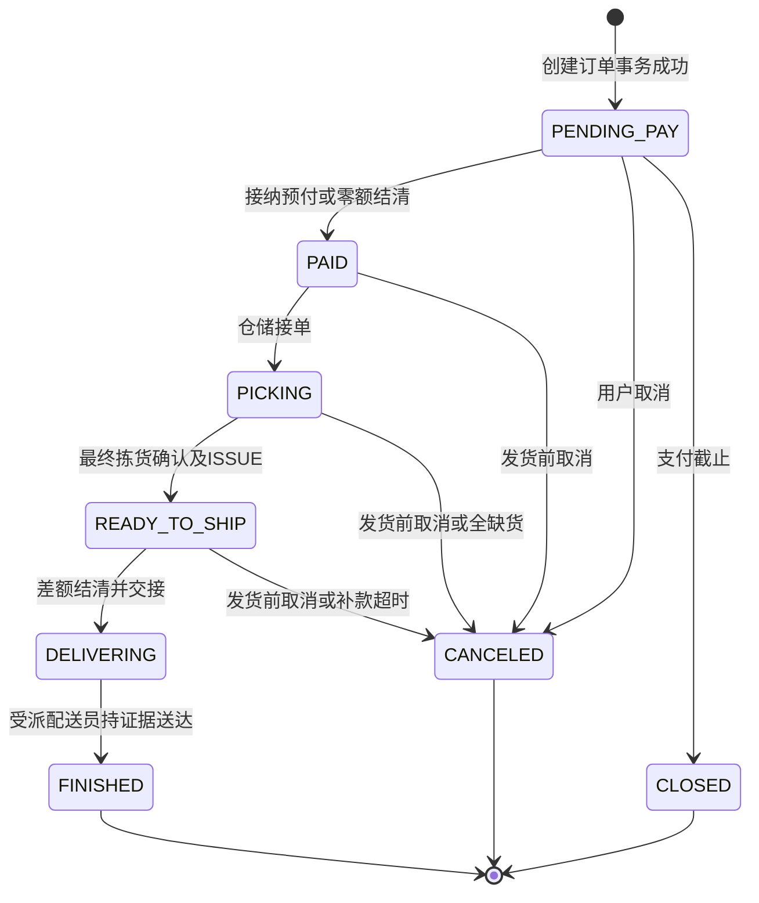

# 状态与事务模型 v0.1

版本：0.1.0；更新：2026-10-18；状态：Codex已定工程演示基线，尚未证明实现通过。

权威为 [BASELINE.md](BASELINE.md)，计算见 [business-rules.md](business-rules.md)，字段和枚举见 [glossary.md](glossary.md)。只允许下表迁移，其他事件返回状态冲突；同幂等命令重放返回原结果。管理员没有跳过守卫的特殊通道。

## SM-01 事务和实体边界

T表示同一MySQL事务内的校验、资源锁/版本、业务写入、库存/资金账、幂等结果和outbox；本地失败全回滚。渠道请求、通知、物流调用在提交后异步执行，重试相同逻辑命令。外部资金已发生不能靠数据库回滚消除，须补偿退款/对账。

订单表示履约，支付表示收款，退款表示返款，售后表示申请，差额表示退补；各自独立。部分退款不覆盖履约状态，支付退款后仍SUCCESS。退款成功不证明实物已回仓。

取消、预付入账、最终拣货、SHIP、补款及补款超时在同一订单锁/version下串行判定，全局锁顺序为幂等记录→订单→支付/退款→优惠券→时段→按SKU/批次稳定ID；新下单使用该顺序子集，新插订单不锁不存在行。条件更新必须检查受影响行数；前端禁用按钮不代替服务端授权与状态判断。业务时钟由服务端提供。

## SM-02 订单

| 当前→目标 | 触发者/事件 | 前置条件 | 同事务动作及补偿 |
|---|---|---|---|
| 无→PENDING_PAY | MEMBER创建 | 自有地址、有效未消费报价、可售批次、券可用、时段未截止有容量 | T消费报价、订单/行快照、FEFO RESERVED allocations、reserved增加、used增加、券LOCKED、15分钟deadline、关单outbox；失败全回滚 |
| PENDING_PAY→PAID | 验真渠道/系统零额结清 | 首笔可接纳预付、now<deadline、金额币种绑定匹配；零额payAmount=0 | T唯一资金入账或零额事件、券USED、通知仓储；onHand/reserved/名额不变 |
| PENDING_PAY→CANCELED | 所属MEMBER | 仍未付、version一致 | T释放有效预占/名额/券，关闭待付尝试；迟到实收另退款，不恢复订单 |
| PENDING_PAY→CLOSED | 系统超时/回调发现已截止 | now≥paymentExpiresAt且仍PENDING_PAY | T关闭并释放预占/名额/券；如实收已发生，为payment建立唯一晚付退款 |
| PAID→PICKING | PICKER接单 | 有有效分配、权限/任务范围满足 | T领单、拣货任务、状态/version；仍在库预占 |
| PICKING→READY_TO_SHIP | PICKER最终确认 | 所有量和批次合法、无超重、库存足够、覆盖时段；正差额有未来截止 | T补足/释放预占，ISSUE、allocation终态、冻结金额、差额/outbox、订单READY；渠道失败不回滚已出库事实 |
| PAID/PICKING→CANCELED | 本人取消/受权客服缺货处理 | 尚未SHIP、订单未终态 | T释放未ISSUE预占和名额，终止任务，差额取消，安排未覆盖退款额度；无ISSUE不造回库量 |
| READY_TO_SHIP→CANCELED | 本人/授权SERVICE/补款超时系统 | 尚未SHIP；SERVICE须在本店客服处理范围并留取消原因；超时须TOP_UP_PENDING且now≥deadline | T取消订单/差额，释放名额，建立ISSUE商品回库质检任务及退款；不立即增加onHand |
| READY_TO_SHIP→DELIVERING | PICKER交接给COURIER | 有真实交接记录、差额NONE/REFUNDED/SETTLED、无取消/未解决履约异常 | T配送任务/受派人/交接时间/状态；库存已ISSUE不再扣，名额保持 |
| DELIVERING→FINISHED | 受派COURIER确认送达 | 本人受派任务、有效proof、未完成、无未解决异常 | T写deliveredAt和finishedAt、proof引用、状态/version、结算及评价事件；不再扣库存、不回填历史名额 |

FINISHED/CANCELED/CLOSED履约终态不可重开。DELIVERING普通取消409。v0.1不引入DELIVERED中间态、24小时自动确认或新增用户确认收货接口；如以后支持用户确认，不能重复触发结算。未完成配送的异常保持DELIVERING并交客服处理，不能用虚假proof完成；增加异常终态须版本化合同。

配送任务异常恢复：授权SERVICE通过`POST /api/v1/admin/delivery-tasks/{taskId}/resolve-exception`处理本店客服范围内的任务，必须携理由、version和Idempotency-Key。前置为任务EXCEPTION且订单仍DELIVERING；T记录解决原因及操作者，将任务EXCEPTION→DELIVERING并恢复原受派COURIER继续履约，订单保持DELIVERING。此命令不能改变收退款、伪造完成凭证或把订单标FINISHED；真正送达仍由原受派配送员按proof守卫完成。

## SM-03 支付尝试与入账

| 当前→目标 | 事件 | 守卫与原子动作 | 异常与补偿 |
|---|---|---|---|
| 无→INIT | MEMBER原付/补款 | T自有订单/差额、可付状态、金额>0且未截止；唯一merchantPayNo/purpose/金额/幂等结果 | 金额从服务端快照读取 |
| INIT→PENDING | 系统渠道受理 | 写渠道会话/单号，复用相同商户号 | 网络未知保持待查询，不重复建立渠道交易 |
| INIT/PENDING→FAILED | 渠道确认失败 | 验真且确认未收款 | 订单截止前仍可发起另一尝试，不能直接关订单 |
| INIT/PENDING→CLOSED | 取消/截止/渠道关闭 | 记录原因并异步关闭渠道会话 | 不能假定关闭调用撤销已收款 |
| INIT/PENDING→SUCCESS | 回调/可信查询 | T验金额币种绑定、事件及资金账唯一，按当前原单/差额守卫尝试入账 | 守卫不满足则记录SUCCESS但不分配入订单，唯一原路退款 |
| FAILED/CLOSED→SUCCESS | 迟到成功/对账 | 仅外部可信实收证据纠正资金事实，复用入账逻辑 | 订单终态不改变，客户端不能触发 |
| SUCCESS→SUCCESS | 重复成功 | 幂等返回，不重复入账/退款 | 金额/渠道交易号不符进入对账异常 |

原付入账仅当order=PENDING_PAY、now<paymentExpiresAt、无已接纳预付、金额=payAmount。补款仅当order=READY_TO_SHIP、adjustment=TOP_UP_PENDING、now<topUpDeadline、无已接纳补款、金额=正差额。失败/关闭尝试迟到的真实收款不会被丢弃；无法入账必须退款。

SUCCESS没有回退到FAILED/CLOSED的迁移，退款金额另计。零额订单使用系统零额结清事件，不伪造第三方成功payment。渠道已收而回调迟到到截止之后，即便渠道paidAt较早，也不复活已截止订单，统一退款，以服务端截止守卫保持确定性。

## SM-04 退款

| 当前→目标 | 触发者/事件 | 守卫与事务 | 失败处理 |
|---|---|---|---|
| 无→PENDING | 自动规则/SERVICE批准售后 | 原payment SUCCESS、amount>0、来源唯一、成功+预留退款≤实收；T按原路拆refund并预留额度。人工售后此时不投递付款outbox，等待财务授权；自动规则可投递系统执行事件 | 额度不足拒绝/异常，不静默截额 |
| PENDING→PROCESSING | FINANCE执行人工退款/系统执行自动退款 | 人工退款要求有效财务授权且executor≠reviewer；T写执行授权、状态和渠道outbox，复用原refundId/merchantRefundNo及已有预留，不重复建单占额度 | worker发送前再次校验人工退款的财务授权，不得扫描PENDING直接付款；网络未知保持PROCESSING并查询 |
| PROCESSING→SUCCESS | 验真回调/查询 | 金额币种原付匹配、事件唯一；T预留转成功并推进父实体 | 订单履约不随退款更改 |
| PROCESSING→FAILED | 渠道明确失败 | 保留额度、写失败码/重试策略、告警 | 未知不能标FAILED，不释放额度另发一笔 |
| FAILED→PROCESSING | 系统/FINANCE重试 | 查询确认未成功，复用原逻辑号与预留；人工退款必须已有有效财务执行授权 | 有限重试后人工队列，不无限循环 |
| PENDING/FAILED→SUCCESS | 可信渠道对账 | 回调先到或迟到也按相同资金唯一约束处理 | 不再调用渠道重复退款 |
| SUCCESS→SUCCESS | 重复结果 | 返回原结果无新增资金事件 | 不符转对账工单 |

客户端无直接SUCCESS操作。父售后/差额如拆多笔原路退款，全部成功才完成。失败父状态保持REFUNDING/REFUND_PENDING，明确展示处理中/失败待处理。已成功、PENDING、PROCESSING、FAILED退款额度均纳入取消预算覆盖，取消只创建其余金额。

退差未成功阻止发货是本版明确门禁。worker以原逻辑退款号退避重试并主动查询；重试耗尽由FINANCE核查渠道状态后按同单重试或受控取消退款，不能手工把退款标SUCCESS绕过门禁。临近配送时段仍失败要告警给仓储/客服，通知用户履约异常，不承诺无条件准时。

## SM-05 称重差额

| 当前→目标 | 事件 | 条件及动作 |
|---|---|---|
| 无→NONE | 最终拣货确认 | 净差0，保留逐行计算，允许发货 |
| 无→REFUND_PENDING | 最终拣货确认 | 净差<0，T预留退款额度/outbox，禁止发货 |
| REFUND_PENDING→REFUNDED | 关联退款全部成功 | SUCCESS合计=应退额，T解除发货资金门禁 |
| 无→TOP_UP_PENDING | 最终拣货确认 | 净差>0，deadline=min(now+10分钟,slot.startAt)>now，通知买家 |
| TOP_UP_PENDING→SETTLED | 首次接纳补款 | 订单READY、未截止、金额匹配；T唯一入账，允许发货 |
| NONE/REFUND_PENDING/REFUNDED/TOP_UP_PENDING/SETTLED→CANCELED | 发货前订单取消 | T终止调整履约作用并保留历史；渠道退款仍完成并计入整单取消预算 |

TOP_UP_PENDING到期触发订单和差额CANCELED，不假装SETTLED。迟到退款只记资金账不重开调整；迟到补款唯一原路退。最终确认不再改实际量；同键重放不再次出库，确需纠错按取消回库流程处理。

## SM-06 售后

| 当前→目标 | 触发者 | 守卫与事务 |
|---|---|---|
| 无→APPLIED | MEMBER | 自有FINISHED、now<deliveredAt+7天、金额>0且≤行可退现金，无同明细处理中单；T申请/证据/幂等 |
| APPLIED→APPLIED | SERVICE独立claim领取 | 本店客服处理范围、尚未被其他人领取；T按version和幂等键记录当前客服为处理人。领取成功后才允许其访问申请证据图片并审核，不在approve/reject中隐式领取 |
| APPLIED→CANCELED | 原申请人 | 未审核，T撤销原因，不影响库存订单 |
| APPLIED→REJECTED | 已领取该单的SERVICE | 当前处理人为本人、已完成证据审阅、审核理由必填；T记录审核主体/时间，无退款 |
| APPLIED→APPROVED | 已领取该单的SERVICE | 当前处理人为本人且已完成证据审阅；批准额≤申请额及剩余行现金；T记录审核人、按原路创建PENDING退款并预留行及payment退款额度，防并发超赔；不投递付款outbox |
| APPROVED→REFUNDING | FINANCE | executor≠reviewer；T授权执行既有PENDING退款、改PROCESSING并写outbox，不重复建退款或预留额度；幂等 |
| REFUNDING→COMPLETED | 系统退款聚合 | 全部子退款SUCCESS；T完成及品质损失归因，不回库存不重复扣实物 |

退款失败仍REFUNDING。REJECTED/CANCELED为该申请终态，期限内可用新证据重申请，仍受一行处理中唯一约束和现金封顶。COMPLETED不再付款；新申请只使用剩余可退额。审批后不能用户撤销已冻结退款流程。

## SM-07 批次、allocation、券、回库

| 批次迁移 | 事件 | 守卫及动作 |
|---|---|---|
| 无→NORMAL | PICKER验收入库 | 单位日期量合法，T INBOUND和onHand，默认reserved/quarantined=0 |
| NORMAL→QUARANTINED | PICKER/系统隔离 | 先重分配或取消预占订单，reserved=0，quarantined=onHand并记录原因 |
| QUARANTINED→NORMAL | PICKER质检解封 | 质检合格未过期，释放隔离并记录证据；过期不可解封销售 |
| NORMAL/QUARANTINED→DISPOSED | PICKER实际全量处置 | 无预占，全部实物先隔离，T报废扣onHand/quarantined至0，成本原因留档 |

部分隔离/处置保持原生命周期并记数量流水，DISPOSED终态不再入库。freshness按时钟派生，过期立即不可分配，不等待任务。预占批次变得不适合配送或被隔离时进入履约异常，必须原子重分配/取消，不从失效批次继续发货。

allocation初始RESERVED；最终拣货取用→ISSUED；取消/关单/全量短拣/换批释放→RELEASED。部分取用保留原reservedQuantity、实际pickedQuantity及差额释放流水，状态ISSUED；所有allocation的实际量之和=行实际量。ISSUED/RELEASED不重写，RETURN引用原allocation，累计返还不能超过已ISSUE未返还量。

券发放AVAILABLE；下单LOCKED；首次订单入账USED；未付取消/关闭回AVAILABLE或EXPIRED；AVAILABLE到期EXPIRED。过期任务不覆盖LOCKED/USED；预占订单在其15分钟内继续履约。USED不因退款恢复。

READY取消只建待回库任务；实际收到核对来源后T onHand+=q、quarantined+=q、RETURN。合格未过期质检再减quarantined；不合格实际处置记DISPOSE。每步独立幂等/证据，未知去向、未收到或品质仅退款没有RETURN，因此不增加可售量。

## SM-08 竞态的确定结果

| 竞态 | 唯一决策点 | 允许结果与禁止结果 |
|---|---|---|
| 最后一份库存争用 | 批次锁/条件更新+allocation同T | 一成功一缺货，不能available负数 |
| 最后时段名额争用 | used<capacity条件更新同T | 一成功，失败单库存/券全回滚 |
| 同券两单 | 券owner+状态条件更新 | 一个LOCKED，禁止双抵扣 |
| 成功预付与关单 | 订单锁+deadline | 截止前先入账PAID、关单无效；已截止先关闭则真收款退款，禁止复活/双释放 |
| 不同尝试双成功 | 订单预付账唯一 | 一笔入账、一笔重复付款退款 |
| 取消与最终拣货 | 同订单锁/version | 取消先则确认拒绝；确认先则按已ISSUE取消回库，不能双加量 |
| 取消与SHIP | 同订单锁 | 取消先SHIP失败；SHIP先普通取消409 |
| 补款与到期 | 订单/差额锁+deadline | 截止前SETTLED，截止取消后真收款退款，禁止取消单发货 |
| 退款重试与回调 | refund逻辑号+资金唯一 | 一份资金事实，先查询原单不新编号重付 |
| 隔离与拣货 | 批次/订单锁 | 隔离批不可新ISSUE，先处理预占；无安全替代则取消/异常 |
| 重复回库扫码 | RETURN来源唯一+累计限额 | 只加一次实物返还；退款不自动RETURN |
| 售后审批与其他退款 | 行现金及支付预算锁 | 累计不超现金，券和已退差额不重复计算 |

本表为待执行规格测试；断言应同时覆盖状态、inventory ledger、payment/refund ledger、名额、券及outbox，不能只检查HTTP200。
