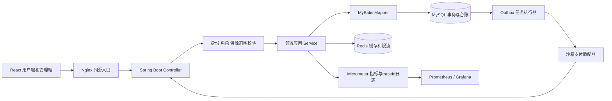
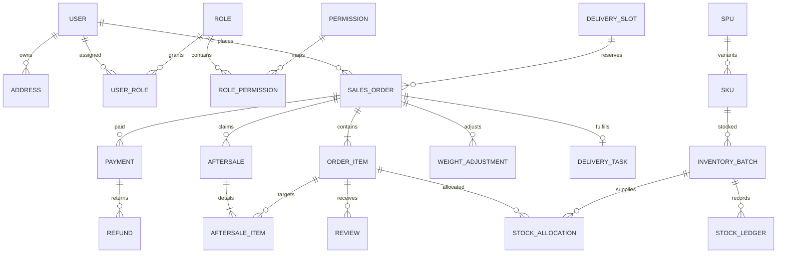

# 企业级生鲜商城设计文档 · 第一版源稿

版本0.1.0，2026-10-18，Codex。设计基线，尚未实现。UI视觉与布局由Claude设计，用户确认后纳入正式文档。

## 架构

模块化单体维持事务一致性，模块按identity/catalog/inventory/checkout/order/payment/fulfillment/aftersale/reporting/audit分包。HTTP只有一个写入口，所有状态变更走应用服务，不直接暴露任意状态字段PATCH。实体不直接序列化给客户端，用按权限裁剪的DTO。

## 核心领域与ER关系

图仅显示主要业务关系；报价、券实例/核销、会话、幂等记录、outbox与审计是必需辅助实体，不因省略于图而省略实施。每表有创建/更新时间，业务聚合有version，金额为bigint分，数量使用基础单位整型。对外ID序列化为字符串。订单号独立唯一，订单行保存名称、单价、计价单位、券分摊、配送与地址快照，历史不随商品编辑改变。

## 一致性与数据库约束

1. 全局固定锁顺序：幂等记录→已有订单→支付/退款→券实例→时段→按sku/batch稳定序库存行；各命令按触及资源取此子序列，新下单不锁不存在的订单。确认报价属于当前用户且未到期，重验价目/规则版本；占用券、容量、批次后创建订单/行/分配/outbox，同事务提交。
2. 库存不变量：onHand>=reserved+quarantined>=0；eligible available求和，批次必须覆盖配送结束时刻。条件UPDATE或FOR UPDATE后核验；索引(skuId, lifecycleStatus, expiresAt, id)支持FEFO范围查询。禁止无锁“先查后减”。
3. 支付：payment的渠道流水号唯一、渠道事件ID唯一；成功事实与订单入账唯一绑定分开。回调锁支付与订单，状态+截止+金额匹配才进入PAID；其他有效扣款进入唯一退款任务。无法验真返回失败，不伪造成功应答。
4. 拣货：校验expectedVersion与所分配批次；实重增加必须增量预占成功，减少释放；最终单事务把实际分配reserved/onHand同步减少、写台账与称重差额。若尚需补款，仍READY_TO_SHIP但发货守卫拒绝。
5. 退款：申请/审核/执行/成功分开；预占可退额度锁，防并发超额。总退款不能超过各成功支付实收；退款请求唯一业务键，重试同渠道请求号。品质退赔不增加或重复减少已经出库的库存。
6. 配送名额采用日期+时段唯一行；booked<=capacity；已完成订单不回填过去的容量。调整capacity不能小于现booked。取消仅释放一次。
7. outbox与业务同事务落库，worker至少一次投递，下游按事件唯一键去重。任务重试指数退避并有死信/人工恢复入口；数据库定时扫描超时订单作为漏调兜底。

## 读模型与权限

商品列表缓存公开信息，不缓存顾客价格/地址混合结果；用户报价不可共享。按操作授权后加owner/store/warehouse/assignee条件，避免根据id直查任意资源。财务只看必要账务字段，配送地址仅当前任务可见，客服按工单必要程度脱敏；日志不保存密码、token、回调密钥与完整手机号。

管理员授权、库存调整、价格编辑、退款审核执行、出库与配送、上传访问都写不可由业务用户改写的审计事件：actor、scope、operation、resource、before/after摘要、reason、traceId和时间。审计访问本身受限。

## API与部署

接口来源为contracts/openapi.yaml，通用类型与幂等约定见conventions；后端输出与合同进行漂移检查，Codex据此生成TS类型及MSW。鉴权cookie、CSRF、CORS和开发代理见ADR-001。

部署单元：frontend/nginx、backend、mysql、redis、prometheus/grafana（监控可用profile启用）。镜像不可变tag/digest；数据库Flyway迁移不可修改已执行文件。demo种子按baseDate生成正常/临期/过期与竞态测试库存；禁止用原始写死日期做当前可售库存。正式初始化与演示重置必须分开，重置命令显式拒绝prod。

发布：构建测试→契约校验→迁移校验→镜像构建→Compose健康检查→业务smoke→记录版本。回滚旧应用前检查schema向后兼容；破坏性迁移采用expand/contract，备份恢复实际演练后才记录成功。

## 尚待实现与验证

当前只完成设计和契约，不声称数据库已建、接口可调或负载达标。下一步实施数据库迁移与库存/订单/支付纵向切片，再验证并发、幂等、越权与异常恢复。UI方案未获用户确认时，Codex先实现无视觉依赖的API客户端及mock骨架，Claude专注供用户确认的视觉方案。PPT当前暂停。
