# 东华大学社区生鲜超市系统需求文档

图文修订版 功能说明与运行画面

文档日期 2026年10月21日　工程证据 v0.3.1系统版（含v0.3.0基线与review-state-v031证据）　接口证据 0.2.2

学校：东华大学　课程：AI辅助开发实践　组长 戴家轶；组员 戚宇暄、刘寒立、李金瑞

本系统面向东华大学校园社区的生鲜采购与门店履约场景，提供从选购、沙箱支付、称重拣货、配送到售后和评价的完整业务路径。项目将库存批次、资金记录、员工数据范围和可复现运行作为验收重点。当前本机系统、Railway 公网版本与专项实测均已形成证据；固定资源持续压测、Linux 干净安装、远端 CI 和最终课程交付物仍需补齐，不能把部分上线证据写成全部课程验收通过。

本次更新选用三位队友提供的材料：两位队友的10月19日、10月21日运行截图，以及成员三于10月19日整理的源码与测试摘录。材料按内容选图与裁切，合成演示标识按原画面保留，用于展示页面功能、业务状态与接口约束。来源与上述v0.3.1工程测试证据分别记录，测试统计沿用原版本结果。[S08]

## 1 项目背景与范围

课程要求完成一个可交付、可运维、可审计的商城，最终提交源码与脚本压缩包、三份正式文档、PPT和不超过15分钟的真实录屏。本需求文档用于统一开发、测试与教师评审口径，需求是否满足必须关联接口、数据结果和实际证据。[S01][S02]

业务设定为东华大学校园社区的一家自营实验超市，采用单店、单仓、人民币结算和校区周边预约配送。此设定是课程案例，不构成学校官方商业平台、真实用户调研或学校授权经营的声明。校园标识用于建立场景辨识度，现行界面采用用户选定的R03版本，R04及历史版本保留供回溯。

目标用户包括日常采购的师生会员、维护商品的运营人员、按批次管理商品的仓储人员，以及配送、客服、财务和管理员。画像依据课程场景提出：会员关心新鲜程度、计价、到货时段和退款；门店关心批次到期、库存守恒、异常可追溯和岗位责任，尚未将这些假设写成实地调查结论。

| 范围 | 纳入第一版 | 边界 |
| --- | --- | --- |
| 购物 | 分类搜索、商品规格、购物车、地址、券、报价、订单与评价 | 单币种；会员基础权益；无多商家入驻 |
| 履约 | FEFO批次预占、称重差额、预约名额、拣货、配送异常、签收 | 单仓；不含真实物流商对接 |
| 售后资金 | 品质证据、客服领取审核、独立财务退款与日对账 | 沙箱渠道；不发生真实收款 |
| 运营治理 | 商品与SKU、批次采购/盘损/隔离、策略、容量、员工治理和审计 | 管理员没有隐含全部业务权限 |
| 工程交付 | 数据库迁移、受控运行、缓存降级、监控、备份恢复、Git记录、Railway 公网部署 | 持续性能、远端CI和完整云端恢复仍待验 |

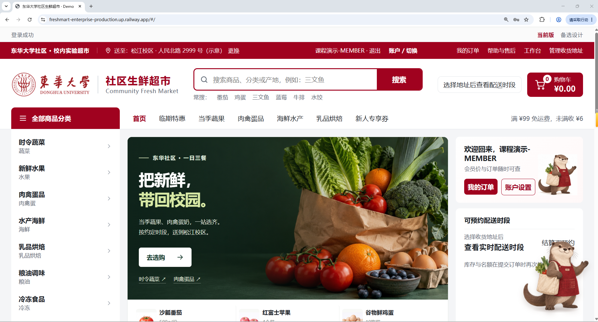

图1　商城首页，展示东华校园元素、分类、搜索、商品推荐与东小锦。

## 2 角色权限与数据范围

系统以角色、操作权限和资源归属共同决定访问，员工身份与MEMBER分开。游客不是持久角色；注册产生会员。员工角色变更或停用会吊销会话，新员工必须先修改临时密码。未登录返回401，缺操作权限返回403，越权访问他人资源返回404。[S03][S04]

| 角色 | 主要操作 | 可访问的数据范围 |
| --- | --- | --- |
| GUEST | 浏览、搜索、注册、登录 | 公开在售商品与公开评价 |
| MEMBER | 购物、支付、取消、售后、评价、取消协助 | 本人地址、订单、资金与证据 |
| OPERATOR | 商品/SKU、上架、交易规则、时段容量、经营看板 | 本店运营数据；不能执行财务退款 |
| PICKER | 采购入库、批次治理、任务领取、称重与实物回库 | 库存台账及本人领取的履约任务 |
| COURIER | 交接配送、报告异常、签收、按需联系 | 分派给本人的配送任务 |
| SERVICE | 领取售后、读取证据、审核、受派取消与异常恢复 | 已领取或明确分派的相关工单 |
| FINANCE | 执行/核验/重试退款、对账、资金投影 | 资金必要字段；屏蔽客户原始备注与仓库细节 |
| ADMIN | 员工创建、角色/状态、审计查询 | 治理数据；购物、拣货、退款需显式业务角色 |

图 角色与核心用例

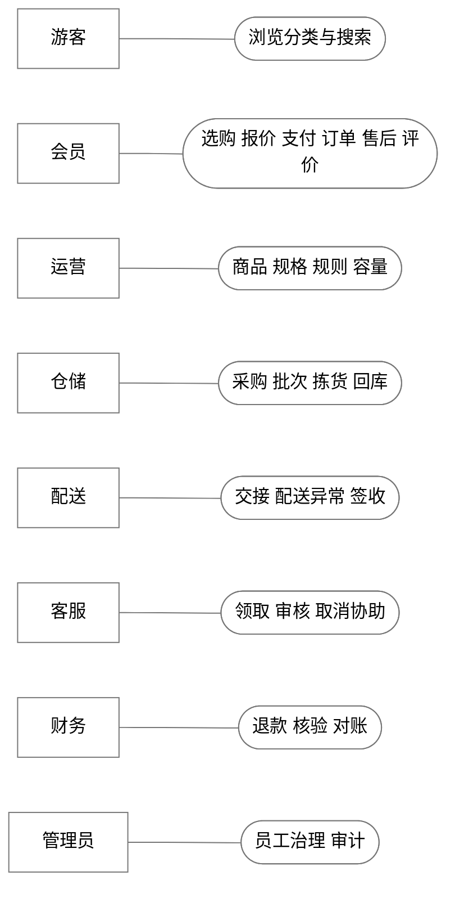

同一人可以被显式授予多个角色，但人工售后审核人与退款执行人必须不同。客服不能在未领取时查看私图，财务不能利用库存流水读取会员的申请原因。管理员最后一名有效管理者受到数据库并发约束，不能依靠前端按钮代替权限判断。

### 2.1 岗位界面实例

以下岗位画面展示各角色的工作内容与业务入口。

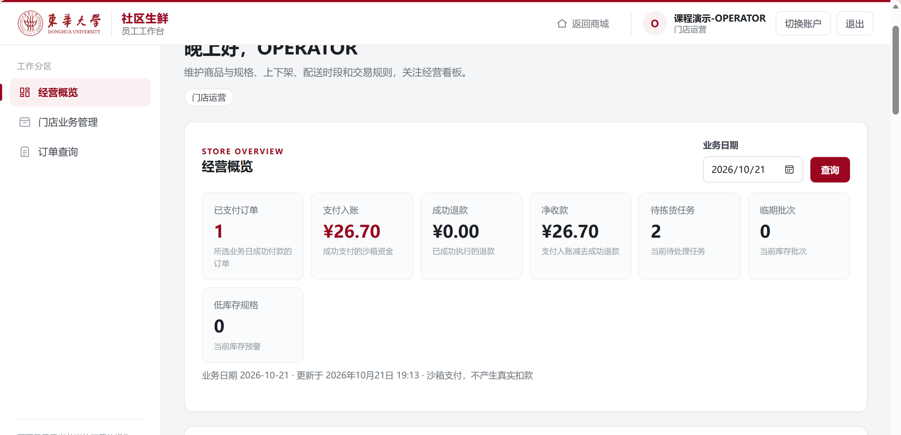

图2　OPERATOR经营概览，展示运营岗位与门店经营数据。

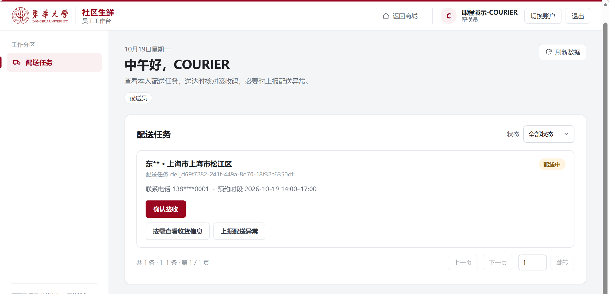

图3　COURIER配送任务，展示分派任务、签收与异常处理入口。

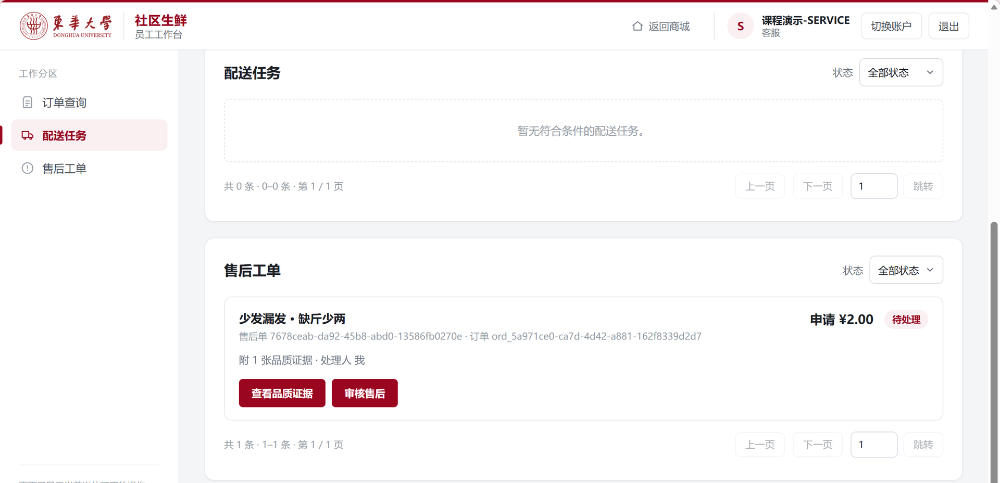

图4　SERVICE待处理售后工单，展示申请金额、品质证据与审核入口。

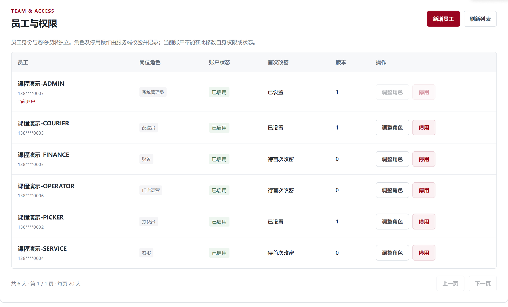

图5　ADMIN员工治理界面，展示员工角色、账户状态、首次改密状态及管理操作。

## 3 业务闭环与状态要求

会员选择商品、基础数量、地址和预约时段后，服务端计算报价并绑定价格、SKU版本、地址版本、优惠与有效期。创建订单在一个事务中预占库存、券与配送名额，任一步不满足即整体回滚。支付只确认资金，实物在库量直到拣货确认才扣减。[S03]

图 购物履约与售后流程

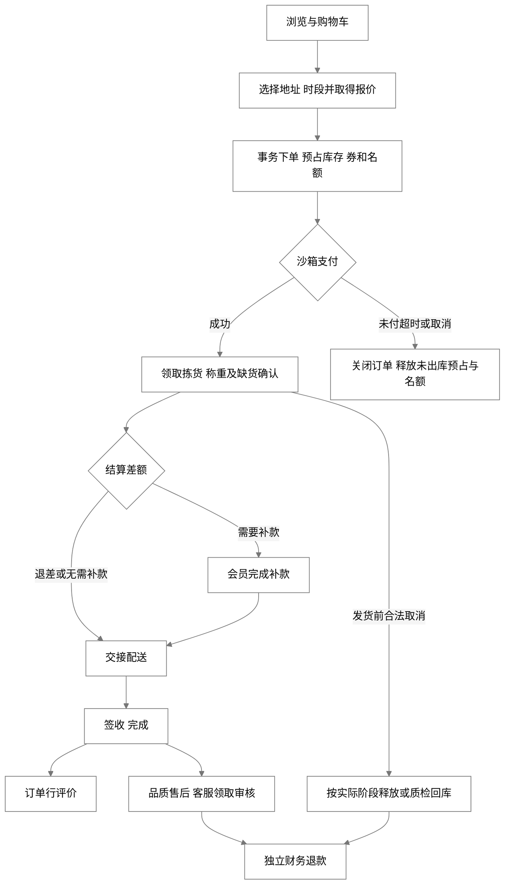

| 对象 | 主要状态 | 不允许混用的含义 |
| --- | --- | --- |
| 订单 | PENDING_PAY、PAID、PICKING、READY_TO_SHIP、DELIVERING、FINISHED、CANCELED、CLOSED | 退款不把订单改成REFUNDED |
| 支付 | INIT、PENDING、SUCCESS、FAILED、CLOSED | 支付成功不等于已发货或已出库 |
| 退款 | PENDING、PROCESSING、SUCCESS、FAILED | 与原支付、订单独立并可追溯 |
| 售后 | APPLIED、APPROVED、REJECTED、REFUNDING、COMPLETED、CANCELED | 领取归属与审核动作分开 |
| 批次 | NORMAL、QUARANTINED、DISPOSED | 临期与过期是按时钟计算的鲜度 |
| 退款任务 | PENDING、PROCESSING、COMPLETED、DEAD | DEAD任务保留待人工核验，不冒充渠道未付款 |

未支付订单15分钟到期后关闭并释放未出库预占与名额。发货前可按状态取消，已付进入独立退款；已拣出库的取消需要逐allocation实物质检回库，退款本身不恢复库存。配送中不支持普通取消，异常由相关客服按授权处理。完成订单不会补回历史时段容量。

### 3.1 业务阶段页面

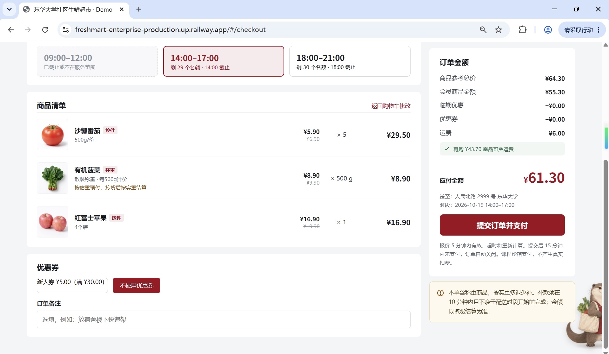

图6　结算页展示商品、称重说明、配送时段、优惠券选择、运费与应付金额。

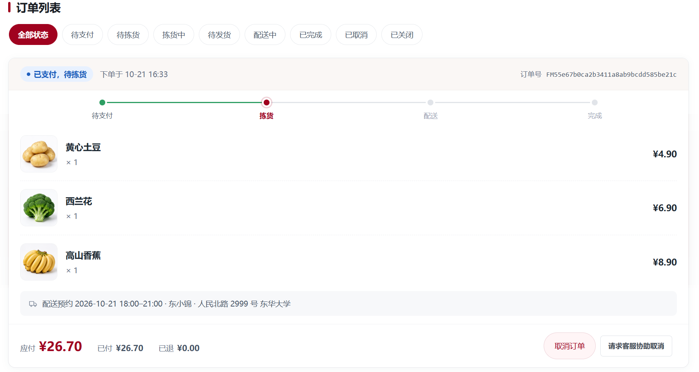

图7　已支付待拣货订单，展示订单状态、商品、实付金额与预约配送信息。

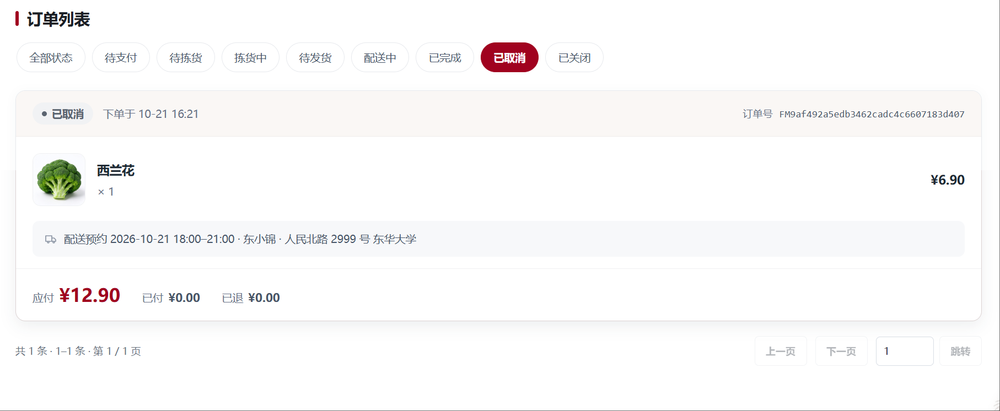

图8　未付款订单取消结果，展示已取消状态及订单金额。

## 4 功能需求与验收条件

| 编号 | 需求 | 可核验的结果 |
| --- | --- | --- |
| FR01 | 浏览、搜索、筛选与分页 | 只展示有效分类及在售有效规格；分页计数和列表过滤一致 |
| FR02 | 购物车、地址和结算 | 地址修改后旧报价不能继续下单；旧订单保留原地址快照 |
| FR03 | 服务端报价 | 会员/临期取低价，再分摊券和运费；不接收客户端可信金额 |
| FR04 | 原子下单 | 订单、批次分配、券、名额同时提交或同时回滚 |
| FR05 | 沙箱支付与回调 | 验签、金额与绑定校验；重复事件只入账一次；晚付唯一原路退款 |
| FR06 | 称重与缺货 | 超估重10%拒绝；多退少补；未结清补款不能发货 |
| FR07 | 履约与异常 | 任务领取和版本受控；异常恢复保留原配送员，不直接写完成 |
| FR08 | 取消协助 | 本人主动申请；独立客服持久分派；请求不冻结履约或改变资金 |
| FR09 | 品质售后 | 完成后7天内按行申请；已领取客服可读私图和审核；财务独立执行 |
| FR10 | 评价与图片 | 完成订单行一行一评；公开副本经过显式发布，不暴露私图访问签名 |
| FR11 | 商品与采购维护 | 空SKU草稿可以保存；上架需有效SKU与受控公图；采购可持续补货 |
| FR12 | 库存治理 | 调整需原因、版本及流水；隔离/报废不能侵占已有预占 |
| FR13 | 财务对账 | 生成不可变差异快照；不自动修账；原号退款恢复不重复增加预留 |
| FR14 | 员工与审计 | 角色/状态变化吊销会话；事件保留当时角色、资源、结果和trace |
| FR15 | 运行与恢复 | 健康、缓存降级、任务重试/死信、受控停启及SQL媒体成套恢复可复查 |

金额使用整数分，数量使用件或克。每500克单价1290分、实重450克的行额为1161分；半分采用逐行四舍五入。运费与券分摊遵循下单快照，称重不回溯增收运费。不同状态下的允许操作应由后端返回，并在执行时重新检查。

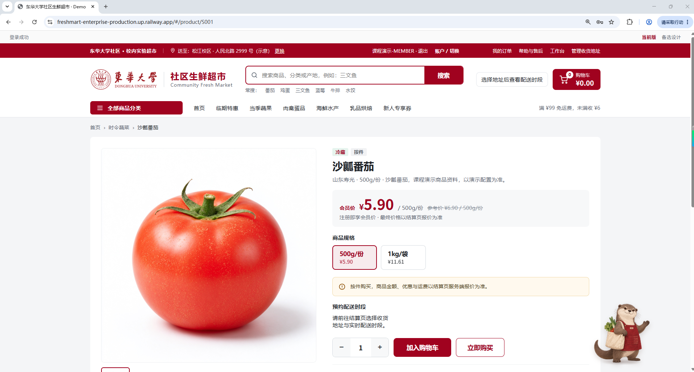

图9　商品详情展示商品图片、按件规格、会员价格与加入购物车入口，对应FR01至FR03中的页面要求。

## 5 领域模型与数据约束

图 核心领域模型

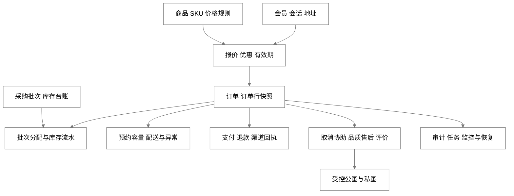

商品SPU表达商品资料，SKU表达计价规格，批次表达入库时间、到期、在库、预占和隔离量。一个订单行可以对应多个allocation，不能把一个批次号直接当作整行唯一批次。领域对象的逻辑关联见下图；具体数据库唯一索引、锁顺序及事务见设计文档。

图 主要数据实体关系

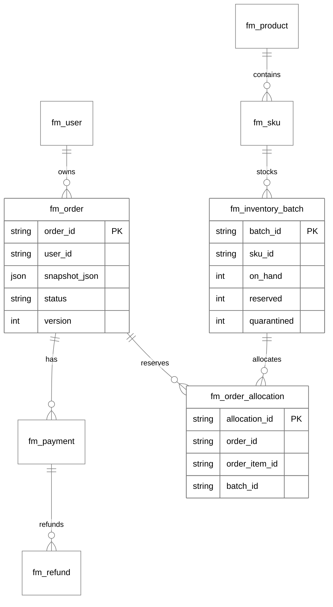

核心不变量为 available = onHand − reserved − quarantined，三项台账及可售量均不能为负。FEFO优先分配先到期且能覆盖配送窗口结束的NORMAL批次。过期、隔离和处置不能通过修改鲜度标签恢复出售；历史未知生产日期保持未记录，新入库须提供真实生产时间。

## 6 非功能需求与证据口径

| 编号 | 可验证目标 | 当前证据与待验范围 |
| --- | --- | --- |
| NFR01 安全 | 角色与资源双校验；CSRF/Origin、密码哈希、会话吊销、私图访问受控 | 有针对性集成与真实E2E；不声称所有角色组合已穷尽 |
| NFR02 一致性 | 无负库存、重复入账/退款、超额退款及重复名额释放 | 有事务/幂等/故障验证；大批量MySQL并发由用户暂缓 |
| NFR03 可维护 | 合同类型生成、分层模块、可重复迁移、版本化Git与测试门槛 | 已有代码与证据；远端CI和干净安装待运行 |
| NFR04 性能 | 校准场景读P95不高于500ms、写P95不高于1000ms、非预期错误率不高于1% | 这是验收目标；需固定资源、十万历史订单、多轮稳态样本，不以单次RT替代 |
| NFR05 可用性 | 候选99.9%月度目标；故障可探测、任务可恢复 | 有本机告警触发恢复；没有30天统计窗，不宣称已达到SLA |
| NFR06 缓存 | 明确key、TTL和分母；故障回数据库且交易不依赖缓存库存 | 公开分类真实命中与停机回退通过；不声称整站80%命中 |
| NFR07 恢复 | 候选RPO24小时、RTO30分钟；SQL与媒体共同恢复 | 有本机一致性恢复；候选时限和目标平台仍需专门计时验证 |
| NFR08 可复现 | 从锁定依赖、SQL迁移、私有配置和说明启动；账号不进Git | 本机可复查；Linux容器、云卷、公网TLS和完整回滚待验 |

任何性能场景出现超卖、重复资金效果或越权，应直接判失败，不能用较高吞吐抵消。预期库存/容量拒绝单列，但仍保留在原始样本分母。NOT_RUN、USER_DEFERRED、FAIL与PASS分别记录，不把计划表当测试结论。[S02][S07]

## 7 需求接口与证据追溯

| 需求组 | 代表接口 | 验证依据 |
| --- | --- | --- |
| FR01至FR04 | categories、products、cart、addresses、orders/quote、orders | 契约；交易、地址与分页E2E |
| FR05至FR08 | payments、pick-tasks、delivery-tasks、orders/{orderId}/cancellation-requests | 沙箱闭环；生命周期及退款恢复 |
| FR09至FR10 | aftersales、media、reviews | 媒体/评价E2E及私图权限验证 |
| FR11至FR14 | admin/products、skus、batches、policies、employees、reconciliations、audit-logs | 运营133响应；治理与审计集成测试 |
| FR15与NFR | health、prometheus、受控运行和备份脚本 | Redis、监控、恢复与构建证据 |

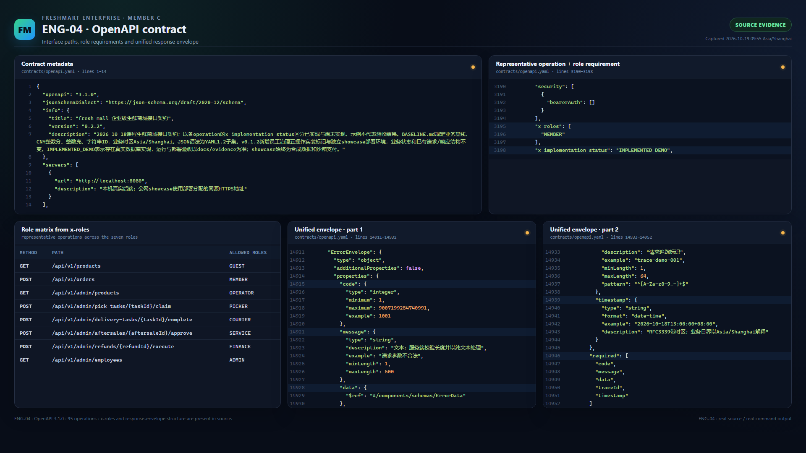

图10　成员三整理的OpenAPI源码摘录视图，显示角色约束和响应结构。

下列清单从当前OpenAPI提取，统一前缀为/api/v1，包含方法、路径、用途及操作ID。它是接口范围清单，不是每条接口已在每种角色下通过完整验收的证明。当前共95项操作，接口证据版本0.2.2；结构后续修订应保留对应版本和新增证据。

### 7.1 会员与公开接口

| 方法 | 路径 | 用途 | 操作ID |
| --- | --- | --- | --- |
| GET | `/auth/csrf` | 获取Cookie变更保护令牌 | `getCsrfToken` |
| POST | `/auth/register` | 注册基础会员 | `registerMember` |
| POST | `/auth/login` | 登录会员或员工 | `login` |
| POST | `/auth/refresh` | 轮换刷新会话 | `refreshSession` |
| POST | `/auth/logout` | 退出并吊销会话 | `logout` |
| GET | `/auth/me` | 查询当前账号 | `getCurrentUser` |
| GET | `/home` | 首页聚合 | `getHome` |
| GET | `/categories` | 商品分类 | `listCategories` |
| GET | `/products` | 分页搜索商品 | `listProducts` |
| GET | `/products/{productId}` | 商品详情与可选SKU | `getProduct` |
| GET | `/products/{productId}/reviews` | 商品公开评价 | `listProductReviews` |
| GET | `/cart` | 查询我的购物车 | `getCart` |
| POST | `/cart/items` | 加入购物车 | `addCartItem` |
| PATCH | `/cart/items/{cartItemId}` | 修改购物车数量或勾选 | `updateCartItem` |
| DELETE | `/cart/items/{cartItemId}` | 删除购物车项目 | `removeCartItem` |
| GET | `/addresses` | 我的收货地址 | `listAddresses` |
| POST | `/addresses` | 新增地址 | `createAddress` |
| PUT | `/addresses/{addressId}` | 修改地址 | `updateAddress` |
| DELETE | `/addresses/{addressId}` | 删除地址 | `deleteAddress` |
| GET | `/delivery-slots` | 查询可预约配送时段 | `listDeliverySlots` |
| GET | `/coupons` | 我的新人优惠券 | `listMyCoupons` |
| POST | `/orders/quote` | 服务端订单报价 | `quoteOrder` |
| POST | `/orders` | 创建订单与原子预占 | `createOrder` |
| GET | `/orders` | 我的订单分页 | `listMyOrders` |
| GET | `/orders/{orderId}` | 我的订单详情 | `getMyOrder` |
| GET | `/orders/{orderId}/status` | 轮询订单状态与退款汇总 | `getOrderStatus` |
| POST | `/orders/{orderId}/cancel` | 发货前申请取消订单 | `cancelMyOrder` |
| POST | `/payments/prepay` | 创建订单或补款沙箱支付单 | `createPayment` |
| GET | `/payments/{paymentId}` | 主动查询支付状态 | `getPayment` |
| POST | `/payments/{paymentId}/sandbox-simulate` | 仅课程沙箱模拟本人支付结果 | `simulateSandboxPayment` |
| POST | `/payments/sandbox/callback` | 接收沙箱签名支付事件 | `receiveSandboxPaymentCallback` |
| GET | `/refunds/{refundId}` | 查询本人退款单 | `getMyRefund` |
| POST | `/aftersales` | 完成后7天内申请售后 | `applyAftersale` |
| GET | `/aftersales` | 我的售后单 | `listMyAftersales` |
| GET | `/aftersales/{aftersaleId}` | 售后详情 | `getMyAftersale` |
| POST | `/aftersales/{aftersaleId}/cancel` | 撤销售后申请 | `cancelMyAftersale` |
| POST | `/reviews` | 评价本人已完成订单行 | `createReview` |
| POST | `/auth/password` | 修改密码并吊销当前全部会话 | `changePassword` |
| POST | `/media/images` | 上传本人订单售后或评价图片 | `uploadEvidenceImage` |
| GET | `/media/{mediaId}/access` | 按用途与归属取得私有图片访问链接 | `getPrivateMediaAccess` |
| GET | `/media/{mediaId}/content` | 读取净化后的私有证据 | `readPrivateMedia` |
| GET | `/media/products/{mediaId}/content` | 读取净化后的商品图片 | `readProductMedia` |
| GET | `/media/reviews/{mediaId}/content` | 读取净化后的已授权公开评价图片 | `readReviewMedia` |
| POST | `/orders/{orderId}/cancellation-requests` | 会员申请发货前订单取消协助 | `requestOrderCancellationSupport` |

### 7.2 员工工作台与治理接口

| 方法 | 路径 | 用途 | 操作ID |
| --- | --- | --- | --- |
| GET | `/admin/dashboard` | 运营与财务概览 | `getAdminDashboard` |
| GET | `/admin/products` | 运营商品分页 | `listAdminProducts` |
| POST | `/admin/products` | 创建商品草稿 | `createProduct` |
| GET | `/admin/products/{productId}` | 运营商品详情 | `getAdminProduct` |
| PATCH | `/admin/products/{productId}` | 修改商品信息 | `patchProduct` |
| PUT | `/admin/products/{productId}/status` | 商品上下架 | `setProductStatus` |
| POST | `/admin/products/{productId}/skus` | 新增SKU | `createSku` |
| PATCH | `/admin/skus/{skuId}` | 修改SKU价格信息 | `patchSku` |
| GET | `/admin/batches` | 仓储批次列表 | `listBatches` |
| POST | `/admin/batches` | 验收入库新批次 | `receiveBatch` |
| GET | `/admin/batches/{batchId}` | 批次库存与派生鲜度 | `getBatch` |
| POST | `/admin/batches/{batchId}/adjustments` | 盘点或损耗调整 | `adjustInventory` |
| PUT | `/admin/batches/{batchId}/lifecycle` | 批次隔离恢复或报废 | `setBatchLifecycle` |
| GET | `/admin/inventory-movements` | 不可变库存流水 | `listInventoryMovements` |
| GET | `/admin/orders` | 按岗位查看订单 | `listAdminOrders` |
| GET | `/admin/orders/{orderId}` | 后台脱敏订单详情 | `getAdminOrder` |
| POST | `/admin/orders/{orderId}/cancel` | 客服执行发货前取消 | `cancelOrderAsService` |
| POST | `/admin/orders/{orderId}/returns/receive` | 取消待发订单实物回库质检 | `receiveCanceledOrderReturn` |
| GET | `/admin/pick-tasks` | 待领或本人拣货任务 | `listPickTasks` |
| GET | `/admin/pick-tasks/{taskId}` | 查询拣货任务及多批次分配 | `getPickTask` |
| POST | `/admin/pick-tasks/{taskId}/claim` | 原子领取拣货任务 | `claimPickTask` |
| POST | `/admin/pick-tasks/{taskId}/reallocate` | 显式重分配批次 | `reallocatePickTask` |
| POST | `/admin/pick-tasks/{taskId}/confirm` | 确认实拣数量及称重净差 | `confirmPickTask` |
| GET | `/admin/delivery-tasks` | 配送任务列表 | `listDeliveryTasks` |
| GET | `/admin/delivery-tasks/{taskId}` | 本人配送任务详情 | `getDeliveryTask` |
| POST | `/admin/delivery-tasks/{taskId}/dispatch` | 拣货人员向配送员交接发货 | `dispatchDelivery` |
| POST | `/admin/delivery-tasks/{taskId}/complete` | 配送员凭签收凭证确认送达 | `completeDelivery` |
| POST | `/admin/delivery-tasks/{taskId}/exceptions` | 记录配送异常 | `reportDeliveryException` |
| GET | `/admin/aftersales` | 客服待领取及本人售后单 | `listAdminAftersales` |
| GET | `/admin/aftersales/{aftersaleId}` | 客服售后详情 | `getAdminAftersale` |
| POST | `/admin/aftersales/{aftersaleId}/approve` | 客服审核批准售后 | `approveAftersale` |
| POST | `/admin/aftersales/{aftersaleId}/reject` | 客服驳回售后 | `rejectAftersale` |
| GET | `/admin/refunds` | 财务退款列表 | `listAdminRefunds` |
| POST | `/admin/refunds/{refundId}/execute` | 财务执行原路沙箱退款 | `executeRefund` |
| POST | `/admin/refunds/{refundId}/retry` | 财务重试失败退款 | `retryRefund` |
| GET | `/admin/reconciliations` | 财务对账结果 | `listReconciliations` |
| POST | `/admin/reconciliations` | 触发沙箱日对账 | `createReconciliation` |
| GET | `/admin/audit-logs` | 管理员审计查询 | `listAuditLogs` |
| GET | `/admin/employees` | 员工账号列表 | `listEmployees` |
| POST | `/admin/employees` | 创建员工账号 | `createEmployee` |
| PUT | `/admin/employees/{employeeId}/roles` | 调整员工角色 | `setEmployeeRoles` |
| PUT | `/admin/employees/{employeeId}/status` | 启停员工账号 | `setEmployeeStatus` |
| GET | `/admin/roles` | 固定角色与权限目录 | `listRoles` |
| GET | `/admin/delivery-slots` | 运营配送时段容量 | `listAdminDeliverySlots` |
| PUT | `/admin/delivery-slots/{slotId}` | 调整时段容量和截止时间 | `updateDeliverySlot` |
| GET | `/admin/policies` | 查询业务策略 | `getBusinessPolicies` |
| PUT | `/admin/policies` | 修改限定业务策略 | `updateBusinessPolicies` |
| POST | `/admin/delivery-tasks/{taskId}/contact-access` | 配送员按需访问本人配送联系信息 | `accessDeliveryContact` |
| POST | `/admin/media/images` | 运营上传商品图片 | `uploadProductImage` |
| POST | `/admin/aftersales/{aftersaleId}/claim` | 客服原子领取售后工单 | `claimAftersale` |
| POST | `/admin/delivery-tasks/{taskId}/resolve-exception` | 客服解决配送异常并恢复原任务 | `resolveDeliveryException` |

## 8 交付状态与待办

本次已将运行截图整理到项目范围、岗位职责、业务阶段和功能需求章节，图片来源与处理记录保存在 `docs/evidence/teammate-captures-20261021/`，并按功能内容配写图注。

源码、数据库与部署准备已有版本记录；本文件与设计文档、测试报告为正式第一版。当前公网入口为 Railway `https://freshmart-enterprise-production.up.railway.app/`，历史记录已复核首页、商品图片、东小锦问答连通与百炼调用。最终ZIP、目标平台干净安装、远端CI和账号安全交付仍需收尾。PPT和视频保留课程最终要求，依用户当前指令暂缓制作。

v0.3.1已增加订单行持久评价状态：仅订单本人得到reviewed、reviewable投影；已完成且实际收到数量大于0、尚未评价的行才可评价。该版后端195项测试与前端44项测试通过，独立MySQL与浏览器专项完成刷新、独立重新登录、分页及零交付行限制验证，具体过程与结果见CODEX-020及其原始证据。

本轮并发方案为100个独立会员争抢10件库存，以及31个会员争抢30个名额。用户明确决定暂不执行，当前0业务HTTP、0业务SQL写入，只保留脚本，不自动恢复执行。公网已采用 Railway 同源 Java 应用与 MySQL，当前可访问网址为 `https://freshmart-enterprise-production.up.railway.app/`；完整外网角色回归、固定资源性能和云端恢复仍需单独验收。

## 9 依据

[S01] 原课程任务书《实验四 企业级应用 XX商城系统》；本文件不改变其最终交付要求。

[S02] docs/acceptance-baseline.md，验收计划与目标，不能单独证明已通过。

[S03] contracts/BASELINE.md、state-models.md、openapi.yaml，业务与接口约束。

[S04] collab/codex/CODEX-015.md至CODEX-020.md，按版本记录实现和实际验证边界。

[S05] docs/evidence/release-v030/、coverage-v030/、redis-v030/、monitoring-v030/，真实结果及原始摘要。

[S06] deploy/backup-verification.json与docs/evidence/restore-sessions-v030/，恢复验证与安全初始化的分开记录。

[S07] docs/evidence/concurrency-v030/user-deferred.json，用户暂缓与零执行事实。

[S08] docs/evidence/teammate-captures-20261021/，三位队友运行截图、源码与测试摘录的来源、选图与裁切记录。
