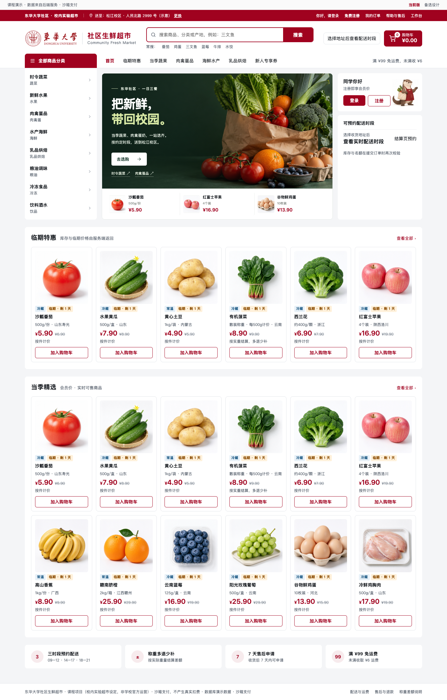
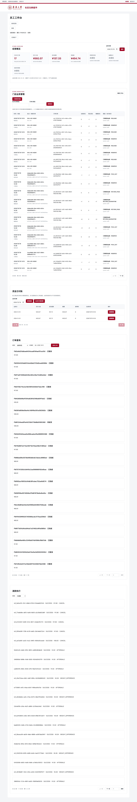
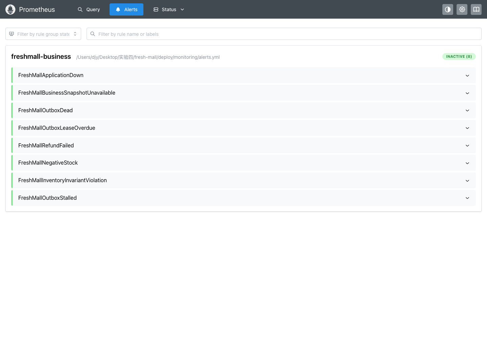

# 东华大学社区生鲜超市系统测试报告

第一版 当前实现与待验边界

文档日期 2026年10月18日　工程证据 v0.3.1系统版（含v0.3.0基线与review-state-v031证据）　接口证据 0.2.2

课程：　　　　　　　　小组：　　　　　　　　组员：

截至本报告冻结证据，系统已通过完整后端195项测试、前端44项测试，以及真实MySQL业务、退款故障恢复、Redis降级、Prometheus告警和本机SQL媒体恢复等专项验证。系统具备可运行的核心闭环与主要企业能力。公网部署、Linux干净安装、远端CI、固定资源持续性能和长期可用率仍未验收；用户暂缓的批量并发未执行，不能给出通过结论。

## 1 测试对象与版本口径

报告冻结工程版本v0.3.1，包含v0.3.0基线及review-state-v031补充，接口证据0.2.2，共95项操作、176个schema。后端构建、主系统安装和浏览器复验的原始记录按版本目录保存；已测JAR摘要见附录。后续合同或代码更新应建立新证据，不能把旧测试数量直接写作新版本实测。

测试以原课程任务、验收基线和当前契约为依据。验收基线中的性能阈值、数据规模和案例均为目标，不自动等于已执行；历史v0.1文档也不是当前事实。结果状态分为PASS、FAIL、NOT_RUN和USER_DEFERRED，预期的401/403/404/409/422在负向用例中可以是正确结果，不能单看HTTP是否200。

## 2 环境与数据

| 项目 | 实际环境 | 能证明的范围 |
| --- | --- | --- |
| 本机 | macOS ARM64，Java21.0.12.1，Maven3.9.16 | 本机构建和原生运行；没有固定2vCPU/4GiB限制 |
| 后端关系测试 | Spring Boot4.1.1、H2 MySQL兼容模式、真实事务与并发线程 | 业务分支和事务测试；不是MySQL压力结果 |
| 真实业务库 | MySQL8.4.11，保留数据应用至V013 | MySQL真实HTTP/数据核对；主库与工程恢复库分开 |
| 浏览器 | Playwright1.62.1、真实Chromium，1440/1024/390等视口 | 实际页面、响应、权限拦截、素材与布局 |
| 缓存 | Redis8.2.10官方固定摘要源码本机编译，16379独立回环端口 | 真Redis命中、污染修复、停起、自然TTL |
| 监控 | Prometheus3.15.0官方包，9090抓独立18081 | 真实采集/内部告警；不是外部通知送达 |
| 前端构建 | Node26、TypeScript5.9.3、Vite8.3.4、Vitest5.0.5 | 类型、生成、单元、构建与Node覆盖率 |
| 平台准备 | CI模板与容器烟测驱动的静态/离线保护检查 | 没有执行Linux容器或远端GitHub Actions |

测试只使用合成账户、地址、商品与订单。秘密、完整SQL、Cookie、token、私图签名和原始私有配置存于Git忽略目录，公开证据按范围脱敏。恢复演练先取停写一致性数据点，再恢复到全新schema、空媒体目录和独立端口，不能清库重置来掩盖失败。

## 3 自动化测试与覆盖率

| 范围 | 真实结果 | 口径和依据 |
| --- | --- | --- |
| 后端完整构建 | 195执行，0失败/错误/跳过 | 独立副本全量verify，含身份、交易、履约、运营、媒体、财务、缓存和监控；T01 |
| 后端行覆盖率 | 2046/2160，94.7222% | JaCoCo0.8.14；所有生产Java类，无类/包排除；60%门槛通过；T01 |
| 后端分支覆盖率 | 69.4143% | 不用行覆盖率代替金额、权限与状态正确性；T01 |
| 前端单元 | 44项通过 | Vitest及生成、类型、生产构建；T02 |
| 前端Node行覆盖率 | 10.61% | 222/2092；UI模块保留分母，真实浏览器E2E未采集并入；T02 |
| 运行安全脚本 | 79项通过 | v030快照65项，加v031源码打包保护14项；T03及review-state-v031/script-checks.json |
| CI准备保护 | 5项通过 | 离线临时目录/模拟进程保护；不是远端CI结果；T12 |
| 静态契约 | 95操作、176schema、2082检查通过 | 形状、引用、示例与规则；不是实际权限/业务证明；review-state-v031/contract-standard-final.json |

上表每行对应独立范围，不应直接相加为一个去重测试总数。监控模块Java测试已包含在后端全量中，不能再次累加；不同版本的浏览器响应也不能合并为当前版本的统一通过率。最终轮通过不抹去历史失败，原失败与修复见第7节。

## 4 真实业务与权限验收

| 场景 | 实际结果 | 证据边界 |
| --- | --- | --- |
| 五岗位完整交易闭环 | 170实际响应；购物、失败支付重试、称重退差、配送签收、售后退款通过 | v0.1.2阶段证据；不代替后续新增功能测试；T04 |
| 运营与仓储 | 133响应；草稿/SKU/上架、入库20、损耗2、隔离/恢复18、流水；容量/策略复原 | 0schema/JS/素材错误；新商品下架保留审计；T05 |
| 媒体评价品质售后 | 116响应、6图片响应；一行一评、私证领取读取、100分独立财务退款 | 成功轮0schema/JS/素材错误；T06 |
| 生命周期与地址 | 生命周期122、地址41实际响应通过 | 取消协助、按allocation回库、地址变更使旧报价失效；T07 |
| 服务器分页 | 最终440响应；101笔合成未支付订单，6页ID无重复 | 每笔正常取消；员工队列未冒称同样有100条实测；T07 |
| 员工治理 | 92响应；首改门禁、两会话吊销、角色/启停和数据投影 | 3个新增测试员工停用；原7账号未改密码；T04 |
| 升级后主Demo冒烟 | 70响应、12张三宽图；七角色列表、管理员员工表、其他六角色403 | 0schema/JS/缺图/外溢；只退出本轮会话；T08 |

上述证据采用真实服务与浏览器响应，没有用接口拦截或mock替代资金和库存结果。UI截图说明对应页面状态，真正的资金、批次和权限结论还要依靠HTTP与数据库交叉核对。

按需求追溯，FR01至FR04由交易、地址、分页和金额用例支持；FR05至FR08由支付/称重/生命周期及退款故障支持；FR09至FR14由媒体评价、运营、治理和对账审计支持。逐95操作全部角色排列的覆盖不能从几组截图推断，后续补完整操作覆盖矩阵。

## 5 退款故障与恢复验收

独立MySQL工程库通过真实下单、沙箱支付和取消产生4笔原退款，每笔1190分。故障计划只在私有loopback demo/test配置，SQL不直接把业务状态改为FAILED或SUCCESS。通过链包括prepare31、HTTP verify16、UI第二轮43、cleanup8，共98条实际响应，schema错误0；另保留首轮UI失败18响应及3张原图。[T09]

| 故障 | 真实过程 | 最终核验 |
| --- | --- | --- |
| 提交前瞬时超时 | 3次超时耗尽，FAILED/DEAD，预留不释放；原号财务恢复 | 累计attempt4；唯一receipt；成功1190、预留0 |
| 提交前明确拒绝 | 一次真实拒绝，FAILED/DEAD；独立财务原号恢复 | 累计attempt2；唯一receipt；成功1190、预留0 |
| 成功后ACK丢失 | 渠道回执独立提交后丢响应，本地核验原号 | attempt1；唯一receipt；只补记一次1190 |
| 真实界面重试 | 保留一笔FAILED供监控；注销会话后旧弹窗提交401不变账，重新登录明确恢复 | 最终SUCCESS；旧资金/任务9字段未因401改变；按钮消失 |

四笔最终订单CANCELED、退款SUCCESS、任务COMPLETED，每笔唯一完整渠道回执、已退1190、预留0。财务陈旧版本409、会员403、原幂等请求重放与原执行人审计均保留。课程沙箱的结果不能当真实支付渠道认证。

## 6 缓存监控与成套恢复

Redis专项保留28次实际HTTP，8个分类的冷读写入真实Redis，第二次hit增加且数据库加载计数不变。坏JSON和错身份分别回数据库修复。只停受管Redis后4次分类仍200、health为UP，耗时3.724、1.985、2.289、1.818毫秒；仅第一次报Redis错误，后3次走短熔断。重启后先miss再hit，自然等待59.262秒观察PTTL到负2，再读发生真实miss/DB加载/写入。[T10]

上述RT仅为本机少量故障样本，不是稳定吞吐或公网延迟，也不推出整站80%命中。分类之外的报价、商品可售和交易继续以数据库为准。

Prometheus专项使用真实官方二进制，8条规则通过promtool合成测试；实际应用测试完成7项抓取权限检查、5阶段17图，观察up为1到0再1，以及DEAD/FAILED的FIRING与恢复INACTIVE。库存破坏、采集陈旧等其余故障只有规则/模块测试，没有人为破坏共享MySQL来冒充全部真实触发。没有Grafana、Alertmanager或外部通知送达证据。[T11]

成套恢复在停止写入与持续读锁下捕获43表、2632行、V001至V012及7个媒体文件，其中商品公图1、私图4、评价公图2。恢复到新schema和空目录，SQL逐字节SHA一致，真实三类图片像素和匿名401、他人404、受派客服/会话绑定通过。新恢复账号不能读取主schema。该43表数字属于当时快照，不能写成V013当前库总表数。[T13]

恢复安全后续修正已实测：旧签名密钥更换不足以吊销不透明refresh；在原始往返验证后，只对新恢复库一次性吊销ACTIVE会话并留count/time，原recovery报告不改。工程18081首次105个，旧版本独立恢复18080后续107个，各为不同恢复目标，不能相加成同一次吊销。两类实例均正常收尾，主库密码未改。[T10][T14]

## 7 失败修复与缺陷状态

| 记录 | 真实问题 | 修复与状态 |
| --- | --- | --- |
| 早期同JAR资源错误 | 浏览器在模板插值前请求占位图片URL | 使用HTMLTemplateElement内容内完成插值再挂载；原失败保留，后续实测无占位请求 |
| 构建/测试尝试 | Clock导入、H2并发SQLSTATE断言、Mockito重设异常桩 | 按实际错误修正；完整最终轮195通过，旧快照不删 |
| Redis初次启动 | Unicode绝对路径被JSON转义，数据目录不存在 | 输出真实Unicode路径；原配置日志保留；增加路径安全测试 |
| 退款UI第一轮 | 脚本等待已被产品移除的旧弹窗按钮禁用 | 保留18响应FAIL；改为移除或禁用且登录框可见、唯一401、数据不变；第二轮43响应PASS |
| 监控等待失败 | 原生页面持续刷新、FIRING按钮名称改变 | 按实际DOM数据就绪等待；保留attempts后重跑 |
| 已评价呈现 | 本轮已增加订单行持久评价状态：仅订单本人得到reviewed、reviewable投影；已完成且实际收到数量大于0、尚未评价的行才可评价。后端195项测试与前端44项测试已通过。刷新、独立重新登录、分页及缺货行的真实浏览器专项仍在复核，最终结论以本报告对应证据为准，不提前写作通过。 | 后续增量应单列契约、代码和测试，不倒填 |
| 前端覆盖/体积 | Node行覆盖10.61%；约655.49KB单包提示 | 尚未完成浏览器覆盖采集与分包优化 |

没有把失败用例从记录中删除或改成通过。退款UI两次尝试为1失败/1通过，最终通过链98响应另列；不据此宣称全部历史尝试100%成功。编译前失败、配置失败和未创建进程的拦截也应与实际业务请求区分。

## 8 尚未执行与用户暂缓

| 项目 | 状态 | 仍需完成的验证 |
| --- | --- | --- |
| 100独立会员库存波及31会员容量波 | USER_DEFERRED | 用户明确暂不执行；0业务HTTP、0业务SQL；脚本保留，不自动重试 |
| 固定资源正式持续负载 | NOT_RUN | 记录硬件/限额、十万历史订单、预热稳态、多轮样本、每operation尾延迟与错误分母 |
| 月度99.9%可用性 | NOT_RUN | 明确SLI和30天统计窗、维护/故障分母 |
| Linux容器与目标卷 | NOT_RUN | 干净构建、健康、UID权限、持久化、重启及成套恢复 |
| 远端CI | NOT_RUN | 模板已有5项离线保护与静态检查，未激活Actions或运行远端作业 |
| 公网HTTPS与完整业务 | NOT_RUN | 云资源、平台域名、私网数据库、账号交付、外网权限和支付沙箱复验 |
| 最终回滚与软件包 | NOT_RUN | 版本/迁移兼容、完整ZIP清单与SHA、独立复现人员操作 |

自动审批曾拒绝批量持久写入，命令未创建进程；之后用户选择暂缓。两条历史都保留，当前状态以USER_DEFERRED为准，不称为产品并发失败或测试通过。[T15]

## 9 结论与后续验收

当前已具备可评审的本机完整业务和多项可复查企业能力。教师可沿需求编号、接口契约、真实HTTP与数据库快照检查结果，复现时须使用该证据对应版本及私有配置，不将此第一版当成正式生产上线证明。

后续先补当前新增结构的验证，再完成干净Linux与目标平台部署、远端CI及账号交付，按获准范围做持续性能。最终打包、三份文档修订和展示材料应与同一发布版本对齐；PPT和视频当前仍按用户要求暂停制作。

## 10 证据索引与复现入口

| 编号 | 项目相对路径 | 用途 |
| --- | --- | --- |
| T01 | docs/evidence/coverage-v030/backend-summary.json | 完整测试、原始JaCoCo计数和JAR摘要 |
| T02 | docs/evidence/coverage-v030/frontend-unit-summary.json | 前端44测试与低覆盖率分母 |
| T03 | docs/evidence/release-v030/root-checks.json | 65运行脚本测试与静态合同检查 |
| T04 | collab/codex/CODEX-015.md | 早期闭环、治理及对应证据位置 |
| T05 | docs/evidence/formal-operations-v020/ | 运营/仓储133响应、图与清理 |
| T06 | docs/evidence/formal-media-v020/ | 媒体、评价、品质售后 |
| T07 | collab/codex/CODEX-017.md及对应证据 | 地址、分页、取消协助和回库 |
| T08 | docs/evidence/release-v030/ | 主Demo升级、七角色与三宽冒烟 |
| T09 | docs/evidence/refund-recovery-v022/ | 真实退款故障、UI与失败attempt |
| T10 | docs/evidence/redis-v030/ | Redis实际响应、指标和工程安全初始化 |
| T11 | docs/evidence/monitoring-v030/ | 真采集、权限、告警触发恢复与规则测试 |
| T12 | deploy/ci/local-verification.json | 5项离线保护、平台未执行边界 |
| T13 | deploy/backup-verification.json | SQL媒体43表快照的真实一致性恢复 |
| T14 | docs/evidence/restore-sessions-v030/result.json | 旧版本恢复会话吊销与图片复验 |
| T15 | docs/evidence/concurrency-v030/user-deferred.json | 用户暂缓与零执行状态 |

复现入口为scripts/verify-backend.py、frontend/package.json中的verify与build、项目E2E脚本、受控runtime和deploy说明。任何故障注入、停写恢复、批量造数或负载执行均先核实目标与当前授权，不直接对主库重放历史命令。原始私有日志和凭据不随文档发布。

已测JAR SHA256 0c663923ced1ded16f0a6013599a7c01aacfb40b392d7309931b3876249ea9e4
