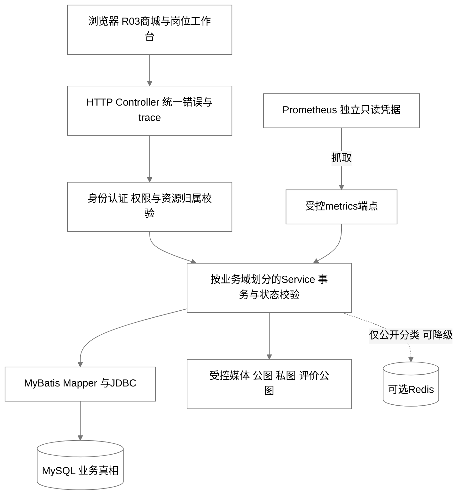
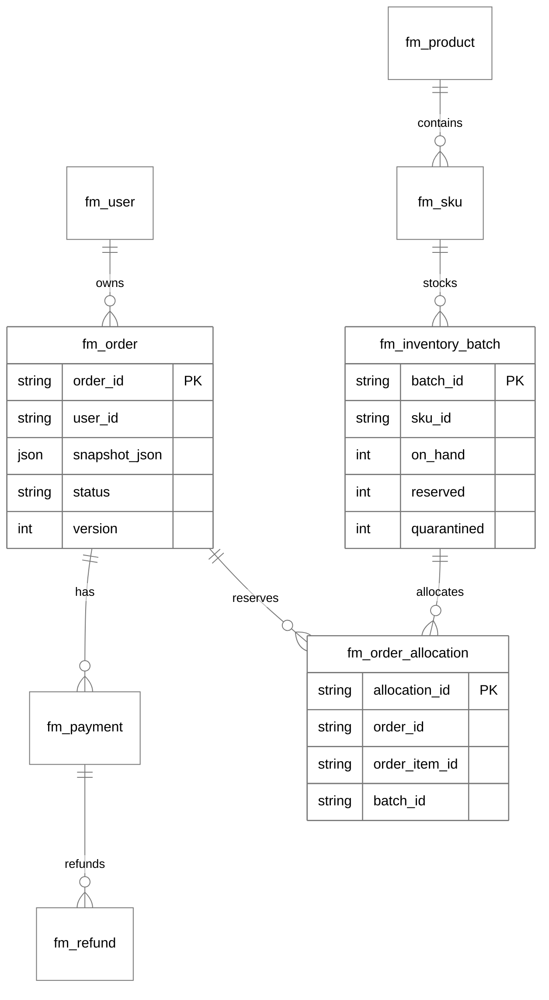
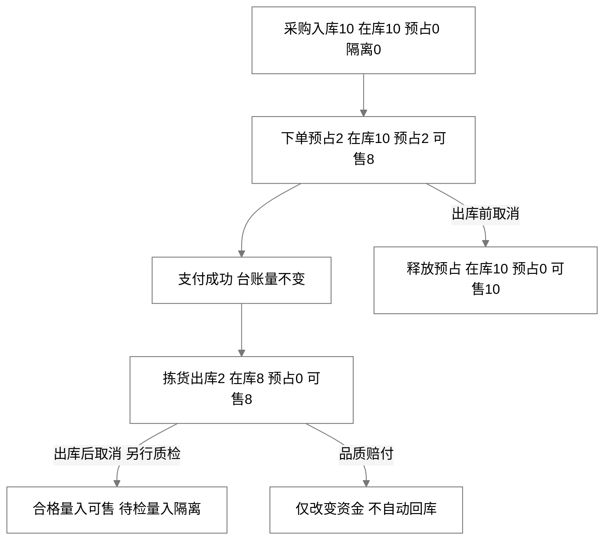
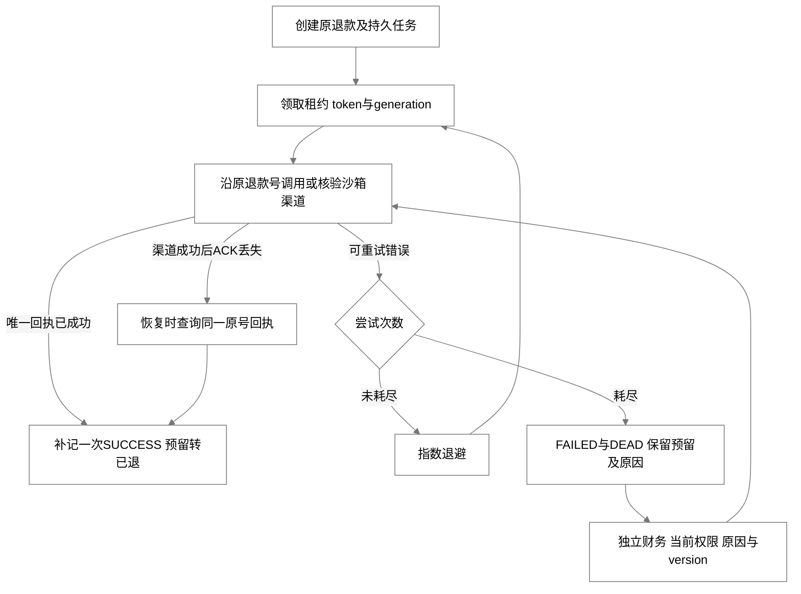
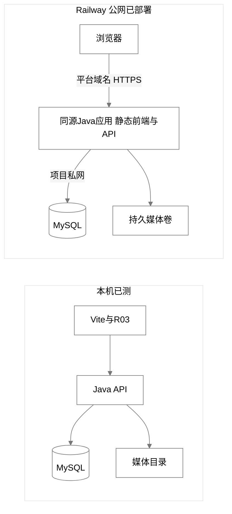

# 东华大学社区生鲜超市系统设计文档

第一版 当前实现与待验边界

文档日期 2026年10月19日　工程证据 v0.3.1系统版（含v0.3.0基线与review-state-v031证据）　接口证据 0.2.2

课程：　　　　　　　　小组：　　　　　　　　组员：

系统采用前后端独立工程与后端模块化单体，以MySQL保存库存、订单和资金真相。核心设计目标是让单店生鲜业务的价格、库存、岗位责任和异常恢复可解释、可测试、可追溯。当前设计已在本机完成多类真实验证，容器、云平台与长期性能仍按待验项目保留；实现说明与已测版本需要一起阅读。

## 1 设计依据与技术选择

架构依据课程任务书、需求文档、接口契约和实际实现展开。单店、单仓与课程团队的规模决定先使用一个后端部署单元，按业务域组织代码，减少跨进程事务和运维成本。模块内遵循Controller、Service、Mapper或Repository分层，控制器负责协议与命令入口，服务负责业务规则和事务，持久层负责受控查询与更新。[D01][D02]

| 能力 | 当前选型 | 理由与替代方案 | 风险或边界 |
| --- | --- | --- | --- |
| 前端 | React19.3.1、TypeScript5.9.3、Vite8.3.4 | 类型化API与已有R03设计；Vue也可满足场景 | 现有业务呈现含模板导入与命令式接线，不能把依赖名当作完整组件化证明 |
| 后端 | Java21、Spring Boot4.1.1、MyBatis4.0.0 | 单体事务与岗位授权易验证；可替换为其他服务端框架 | 模块边界要持续维护，不能演变为控制器直写SQL |
| 数据库 | MySQL8.4.11、Flyway | 行锁、唯一索引、事务与版本迁移；PostgreSQL可替代 | 实测H2不能替代目标MySQL压力与平台验收 |
| 缓存 | Redis8.2.10、Spring Data Redis（由Spring Boot管理版本） | 仅低频公开分类；可完全关闭 | 不缓存价格/库存真相；云端资源是否增加待部署决策 |
| 异步恢复 | 持久outbox与原退款号重试 | 避免本地提交与外部副作用之间丢失任务 | 未部署RabbitMQ/Kafka，不宣称多实例消息基础设施已验收 |
| 监控 | Prometheus3.15.0、Micrometer | 少量低基数指标可追溯故障 | 未部署Grafana、Alertmanager或外部通知 |
| 测试工程 | Maven3.9.16、JaCoCo0.8.14、Vitest5.0.5、Playwright1.62.1 | 单元、关系事务与真实浏览器证据分层 | 浏览器E2E没有自动并入Node行覆盖率 |
| 部署 | Railway 同源Java应用加MySQL；Compose保留作复现备用 | 简化域名、HTTPS、Cookie与静态资源联调 | 公网版本已上线；Linux干净安装、卷恢复与远端CI仍待执行 |

本系统不依赖注册中心、配置中心或外部网关完成单店事务。未来若拆服务，应先证明独立扩容或组织边界需求，再设计跨服务一致性，不将新增技术名作为企业级程度的替代指标。

## 2 系统架构与模块职责

图 系统分层与外部依赖

| 模块 | 职责 | 保持的边界 |
| --- | --- | --- |
| identity与common | 登录、会话、角色、资源校验、异常和trace | 会话变更不能绕过CSRF/Origin；ADMIN不隐式授权业务 |
| catalog与checkout | 公开商品、分类、地址、购物车、券、时段和报价 | 报价由服务端计算，库存仍查询有效批次 |
| commerce与support | 下单、支付、拣货、配送、取消协助 | 状态、预占、名额、资金在事务中协调 |
| operations | 商品/SKU、采购、库存治理、规则和容量 | 有原因、version、幂等与审计，保留历史成交快照 |
| aftersale与review | 品质售后、领取审核、完成订单行评价 | 不将品质退款当作自动实物回库 |
| media | 像素净化、公私存储、会话绑定访问 | 外链与私图不能当商品公图；不抓任意网络图片 |
| finance与observability | 对账、差异、审计、指标和告警 | 对账不修账；监控凭据不能当管理员凭据 |
| cache与command | 可选分类缓存与持久命令幂等 | 缓存失败不吞数据库异常；同键不同体拒绝 |

前端通过OpenAPI生成类型和客户端，以统一错误、分页和命令头接入真实服务。颜色、布局与素材沿用R03；错误恢复、权限提示、分页、版本冲突和未知写入结果属于工程交互逻辑，不以视觉可点击代替服务端约束。

## 3 数据模型与持久约束

数据库按Flyway版本演进，当前工程证据涉及V001至V013。实体关系图表达主要逻辑关联；是否存在物理外键、索引及具体DDL以对应迁移脚本为准，不能仅凭连线推断数据库已自动维护所有业务关系。

图 核心实体与逻辑关联

| 重点数据 | 关键字段或约束 | 目的 |
| --- | --- | --- |
| 用户、角色、员工、会话 | 员工标记与MEMBER分离；会话状态/族、角色快照 | 首改、停用与撤权后真正吊销 |
| 商品、SKU | 字符串ID、规格基础单位、整数价、status、version | 改价不改已下单快照；空草稿不伪造SKU |
| 批次与allocation | on_hand、reserved、quarantined；一行多批次 | 区分可售、预占与实物出库 |
| 订单与报价 | quoteId、token hash、版本、有效期、snapshot_json | 防改价、地址改变、重用或过期报价 |
| 配送时段与券 | capacity/used、状态及version | 预约与优惠券占用同单原子化 |
| 支付、退款与渠道账 | 事件ID/业务唯一键、原支付绑定、金额边界 | 同一成功效果只确认一次 |
| 命令与审计 | actor/route/key、请求hash、结果；事件角色/trace | 拦截不同请求体重放，保留可解释历史 |
| 媒体与评价 | 受控storage key、内容hash、purpose、公开副本、订单行约束 | 防私图越权与重复评价 |
| outbox与渠道回执 | lease token/generation、尝试计数、DEAD、唯一回执 | 进程和网络失败后沿原业务恢复 |

业务金额为CNY整数分，重量为整数克。Java在聚合和乘除时检查安全整数边界，需要时使用大整数中间值；JSON拒绝浮点静默转整数。分页的计数与列表使用同一过滤和数据权限，不能只对已返回的前100条作客户端筛选。

## 4 库存与下单事务

库存只有批次台账一份权威数据。可售量等于在库量减预占与隔离量；批次须为NORMAL、未过期且到期时间覆盖预约窗口结束。按FEFO取先到期批次，再按稳定ID排序；已接订单的allocation保留实际分配，后续重分配需显式命令和版本检查。

创建订单依次锁定主体、报价、地址、时段、券与SKU/批次，验证报价政策指纹、SKU价格/版本、地址版本和时段时间边界。随后写订单快照、预占配送名额和券、分配批次、记预占流水并消费报价。库存或容量不足时所有写入回滚，不留幽灵订单、券占用或名额。

图 库存变化与订单阶段

支付成功不扣onHand。拣货最终确认同时扣onHand与reserved；已拣取消需要原仓储逐allocation确认实物回库，合格量恢复可售，待检量进入隔离。品质赔付只改变资金，不自动恢复已出库库存。盘损、隔离和处置遵守SKU后批次的锁顺序，不能侵占已预占量，必须有原因、版本和流水。

跨主体并发验收脚本已准备，用户暂缓执行。数据库锁可以串行化关键区间；本版不宣称已用100真实会员证明MySQL吞吐或超卖边界。既有关系事务测试和小规模真实案例仍须保留其环境与样本限制。[D04]

## 5 计价与称重结算

服务端先比较会员单价与可用临期批次单价，再计算商品金额，按订单行分摊券，最后确定运费。当前初始规则为优惠后商品满9900分免600分运费，实际规则已持久化且版本化；更新影响新报价，不改历史订单快照。

按重量计价的行额使用实重、每份克数和整数单价计算，逐行四舍五入。估重500克、每500克1290分、实重450克的行额为1161分，退差129分；1291分单价乘250克得到645.5分，半入为646分。券分摊不能超过重算行额，运费保持原快照，禁止负行额和重复退券份额。

实重最多允许超估重10%。在限额内增重需独立补款，期限为生成后10分钟且不晚于时段开始；未结清不能发货，超时取消未发整单并恢复对应阶段库存。部分缺货可将行实际量设为0并明确原因；全部实际量为0应取消并退原实收，不能以空包完成履约。

## 6 资金幂等与退款恢复

变更命令按主体、路由和Idempotency-Key形成持久幂等身份，并保存请求hash与结果。同键同体返回首次结果，同键不同体返回409；其他主体不能取走该结果。写入结果未知时前端暂停新命令，重新登录或查询实际状态，而不是换新键再次退款。

沙箱回调校验签名、时间、nonce、支付绑定、币种与金额，渠道事件ID和资金唯一键共同防重。关单后晚付不能复活订单或重新占库，应生成唯一原路退款。支付SUCCESS与退款实体分别保存，不将支付状态覆盖为REFUNDED。

图 退款任务与渠道回执恢复

退款任务使用可配置指数退避、最大尝试和DEAD终态。每次领取具有租约token与generation，失效工作者不能用旧租约覆盖新处理结果。渠道唯一回执独立提交；成功后丢ACK时，通过同一退款号核验已存在回执，补记一次账务效果。

人工恢复须由有权限的独立财务提供原因与当前version，并沿原退款号核验渠道。已证实渠道成功的结果不能因原执行人后来失权而永久遗漏本地账务；新的资金操作仍检查当前权限、会话和职责分离。私有故障计划仅在显式demo/test与loopback启用，没有公网故障注入API。[D05]

## 7 认证授权与媒体安全

密码采用PBKDF2-SHA256、600000次迭代，不是BCrypt。access token短效并仅在前端内存中使用；不透明refresh token轮换、以hash持久化并可吊销。Cookie使用HttpOnly与SameSite，HTTPS配置开启Secure；本机HTTP开发例外不能写成公网安全验收结论。

Cookie变更端点检查Origin和CSRF，CORS使用准确allowlist。登录失败限制按账户和实际socket对端分别持久计数；默认账户60秒内5次失败封900秒，对端60秒内50次失败封60秒。忽略可伪造转发头，因此代理对端不等于每名互联网访客IP，云部署要复核共享出口影响。[D03]

公开商品、评价公图和私有售后证据分别管理。JPEG、PNG和WebP必须真实解码，限制大小、边长与总像素，并重新编码去除不受控元数据。私图访问绑定当前主体、会话、有效期与签名；会话撤销后旧签名不可继续用。商品公图只接受可信受控PRODUCT资源或已有真实catalog素材，拒绝任意外链和私图路径。

联系方式按需授权并最小展示，页面离开或关闭即清理。联系方式不写入幂等持久结果；财务资金投影不返回会员申请原因和人工仓库备注。审计保存事件时角色、结果和trace，历史未知值保持UNKNOWN或空，不回填虚构身份。

## 8 缓存降级与监控

分类缓存只保存六个公开DTO字段。命名空间通过应用密钥对数据库URL与public origin生成HMAC，恢复库与不同部署不会共享同一分类键。JSON严格检查格式版本、身份、字段、类型、大小和重复项，不用Java原生对象反序列化。

TTL默认60秒并抖动正负5秒。GET失败后短暂熔断，冷却期直接读MySQL，同一失败请求不再尝试SET；坏JSON回数据库并替换。数据库异常在缓存catch之外传播，不伪造空列表或内存旧数据。Redis默认为可选关闭，短连接/命令超时、断线拒绝排队与队列上限限制故障影响；可选Redis故障不使整站健康DOWN。

监控通过独立只读抓取凭据访问metrics，不借用管理员token。指标仅使用固定状态/结果标签，覆盖outbox积压/DEAD、退款失败、库存负值/守恒违规、快照成功与陈旧等。采集失败保留上次数据并另标失败，不能把“上次正常”当作当前正常。Prometheus已真实观察应用UP到DOWN再UP，以及DEAD/FAILED触发和恢复；外部通知尚未配置。[D06]

## 9 部署备份与版本运维

图 本机已测与公网拟采用的部署结构

本机开发使用独立Vite、Java和MySQL；工程故障演练使用新schema、私有媒体目录和独立端口，不清空主数据。受控运行脚本校验PID、启动时间、完整命令、JAR摘要和实际监听PID，拒绝不明占用者，构建使用唯一源码副本而非覆盖运行中的JAR。

公网采用Railway同源Java应用与MySQL，前端构建到静态资源并与API同域，平台域名提供HTTPS；MySQL走项目私网，不暴露公网端口。当前公网地址为 `https://freshmart-enterprise-production.up.railway.app/`，已验证健康、首页素材、动态东小锦图片和百炼问答接口。另备单主机Compose与Caddy方案。平台卷权限、媒体持久化、私网、TLS和外网完整角色回归仍需继续验证。

完整备份必须在停止应用写入并持有数据库读锁期间，取得同一数据点的SQL、三类媒体文件、清单及内容摘要。bundle以独立HMAC密钥认证，文件0600、目录0700，恢复只接受全新隔离schema与空媒体目录，拒绝路径穿越、符号/硬链接、缺图、多图和摘要不符。

恢复先证明原始SQL逐字节往返与媒体像素/权限一致，再作安全初始化。更换JWT/CSRF密钥不能撤销导入的不透明refresh会话，须在新恢复库首次启动前一次性撤销ACTIVE会话并记录count与时间；原备份和恢复报告不改。旧版本回滚还必须核对数据库迁移兼容性，不能只把旧JAR覆盖回去。

CI模板及独立Linux烟测驱动已准备，但尚未激活远端Actions，也未执行Linux构建、镜像运行或云卷恢复。依赖锁、环境模板、版本化SQL、Git标签与真实远端SHA用于复现，凭据和数据库不随源码提交。

## 10 当前限制与变更管理

设计架构、部署、缓存、监控和安全章节的真实画面按 `docs/formal/真实截图采集清单.md` 的 ENG 与 OPS 编号补入；图片只作为证据锚点，不替代代码、接口或测试结果。

本轮已增加订单行持久评价状态：仅订单本人得到reviewed、reviewable投影；已完成且实际收到数量大于0、尚未评价的行才可评价。后端195项测试与前端44项测试已通过。刷新、独立重新登录、分页及缺货行的真实浏览器专项仍在复核，最终结论以本报告对应证据为准，不提前写作通过。

前端单包约655.49KB，仍有构建体积提示，分包和浏览器覆盖率采集待改善。正式持续性能、长期可用率、多实例与目标平台退款/恢复仍待验。新增字段、业务或部署变更应更新OpenAPI与生成类型、记录迁移/兼容性、运行对应测试并保留旧证据，不将新结果倒填旧快照。

## 11 依据

[D01] 原课程任务书、contracts/BASELINE.md、state-models.md、openapi.yaml。

[D02] backend/pom.xml、frontend/package.json与锁文件；实际源码模块和database/migrations。

[D03] collab/decisions/ADR-002-登录限流与密码口径.md及身份/资源权限实现。

[D04] docs/acceptance-baseline.md、docs/evidence/concurrency-v030/user-deferred.json。

[D05] docs/evidence/refund-recovery-v022/README.md及对应HTTP/UI记录。

[D06] docs/evidence/redis-v030/、monitoring-v030/；部分告警只有规则合成测试，不冒称真实应用故障全部触发。

[D07] deploy/backup-verification.json、docs/evidence/restore-sessions-v030/、deploy/ci/local-verification.json。

[D08] collab/codex/CODEX-015.md至CODEX-019.md；docs/待补齐工程范围-v0.2.md。
